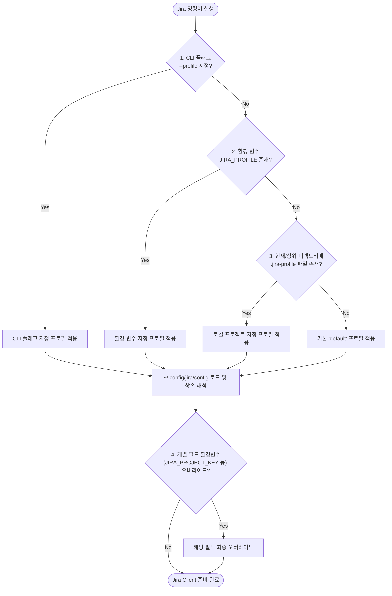

# ⚙️ 설정 및 프로필 아키텍처 (Configuration)

Jira CLI는 보안성과 멀티 테넌시(개인/회사/외주/프로젝트 분리)를 보장하기 위해 **중앙 집중형 INI 멀티 프로필**, **AWS CLI 스타일의 프로필 상속(`source_profile` / `[default]` Fallback)**, 그리고 **디렉토리 기반 로컬 프로젝트 자동 탐색(`.jira-profile`)** 체계를 채택하고 있습니다.

---

## 🎯 1. 프로필 결정 우선순위 (Resolution Priority)

명령어가 실행될 때 활성 프로필(`Active Profile`)은 다음 4단계 계층을 통해 결정론적으로 결정됩니다:



### 상세 우선순위 명세
1. **1순위 (CLI 플래그)**: `--profile <name>` (예: `jira --profile cloit list`)
2. **2순위 (세션 환경 변수)**: `os.Getenv("JIRA_PROFILE")`
3. **3순위 (로컬 프로젝트 파일)**:
   - `pkg/client.go`의 `FindLocalProfile()` 함수가 현재 작업 디렉토리(`cwd`)부터 루트(`/`)까지 상위로 순회하며 `.jira-profile` 또는 `.jira/profile` 파일을 검색합니다.
   - 발견 시 첫 번째 유효 줄을 프로필 이름으로 채택합니다.
4. **4순위 (기본값)**: `"default"`

---

## 📄 2. 글로벌 설정 파일 스키마 (`~/.config/jira/config`)

설정 파일은 표준 INI 포맷이며, 토큰 보안을 위해 파일 생성 시 `0600` (소유자 읽기/쓰기 전용) 퍼미션으로 기록됩니다:

```ini
# 공통 테넌트 1: 기본 인스턴스 (인증 키 1회만 기재)
[default]
instance_url = https://joincdream.atlassian.net
email = joinc.dream@gmail.com
api_token = ATATT3xFfGF0...
project_key = KAN

# 서브 프로젝트: [default] 자동 상속 (인증 키 생략, project_key만 정의)
[jira-cli]
project_key = JC

# 외부 테넌트: 명시적 상속 (source_profile)
[client-mobile]
source_profile = client-corp
project_key = MOB
language = en
```

### 키 정의
- `instance_url`: Atlassian Cloud 인스턴스 전체 URL (끝의 슬래시 `/`는 자동 정규화됨)
- `email`: 계정 이메일 주소 (Basic Auth 사용자명)
- `api_token`: Atlassian API Token
- `project_key`: 기본 대상 Jira 프로젝트 코드 (예: `KAN`, `JC`). 미지정 시 `"KAN"`으로 기본 설정
- `source_profile`: 인증 키를 물려받을 부모 프로필 이름 (생략 시 `default` 자동 상속)
- `language`: 프로필별 기본 UI 언어 (`ko` 또는 `en`). 미지정 시 시스템 OS 로케일 또는 `en`으로 폴백

---

## 🧬 3. 프로필 상속 아키텍처 (Profile Inheritance)

동일 테넌트 내 멀티 프로젝트 운영 시 API 토큰 중복 저장(DRY 위배) 및 토큰 갱신 부담을 원천 차단하기 위해 **AWS CLI 스타일의 상속 엔진**을 탑재하고 있습니다:

1. **암시적 상속 (`[default]` 자동 Fallback)**:
   - 프로필 섹션에 `instance_url`, `email`, `api_token`이 누락되어 있을 경우, 자동으로 `[default]` 프로필의 해당 인증 정보를 물려받습니다.
2. **명시적 상속 (`source_profile`)**:
   - `[default]`가 아닌 별도의 테넌트 프로필을 부모로 상속할 때 `source_profile = <base_profile>`을 지정합니다.
3. **선택적 오버라이드 (Selective Override)**:
   - 부모의 인증 키를 물려받으면서 특정 필드(`project_key`, `language`, 또는 별도 `email`)만 자식 프로필에서 재정의할 수 있습니다.
4. **순환 참조 방지 가드레일 (Safety Guardrail)**:
   - `A -> B -> A` 형태의 무한 루프 탐색 시 즉시 순환 참조 감지 에러를 발생시키고 안전하게 차단합니다 (최대 상속 깊이 5단계 제한).

---

## 📁 4. 로컬 프로젝트 파일 (`.jira-profile`)

각 프로젝트 소스 코드 루트에 `.jira-profile` 파일을 생성하고 프로필 이름 1줄을 작성해 두면, 프로젝트 폴더 내부 어디서든 해당 프로젝트 설정이 자동 적용됩니다:

```text
# /mnt/data/myjob/cloit/jira-cli/.jira-profile
jira-cli
```
- **장점**: 토큰은 안전하게 `~/.config/jira/config`에만 보관하고, 저장소에는 프로필 이름만 매핑하므로 보안과 편의성을 동시에 달성합니다.
