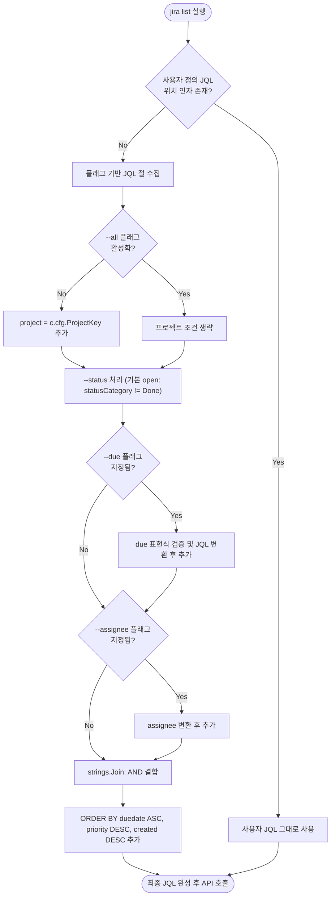

# 📋 [JC-10] jira list 범용 필터 플래그(--all, --due, --status, --assignee) 개발 계획

- **티켓 키**: [JC-10](https://joincdream.atlassian.net/browse/JC-10)
- **티켓 요약**: `[Feature] jira list 범용 필터 플래그(--all, --due, --status, --assignee) 지원`
- **담당자**: AI 에이전트 & 윤상배
- **상태**: 완료 (Done)
- **라벨**: `Architecture`, `Development`

---

## 💡 사용자 관점의 핵심 개선 효과 (What Changes for Users?)

| 구분 | ❌ 현재의 불편함 (Before) | ✨ 개선 후 사용자 경험 (After) |
| :--- | :--- | :--- |
| **전체 프로젝트 조회** | 무조건 현재 프로필의 단일 `project_key`만 조회되어, 관리자가 전체 프로젝트 현황을 보려면 긴 JQL을 외워서 직접 쳐야 함 | **`jira list --all`** (또는 `-A`) 플래그 하나로 **테넌트 내 전체 프로젝트 이슈를 즉시 조회** |
| **마감일/오늘 할 일 필터** | 날짜 조건을 주려면 `duedate <= endOfDay()` 같은 Jira 전용 JQL 문법을 공부해서 입력해야 함 | **`jira list --due today`** 또는 **`jira list --all --due <=today`**로 **직관적인 자연어/날짜 표현 사용** |
| **내 담당 업무 필터** | 매번 `assignee = currentUser()` 쿼리를 수동 입력해야 함 | **`jira list --assignee me`** (또는 `-a me`)로 **내게 할당된 티켓만 즉시 필터링** |
| **완료/진행 중 상태 필터** | 완료된 티켓까지 뒤섞여 나와 가독성이 떨어짐 | **`jira list --status open`** (기본값)으로 **미완료 작업만 깔끔하게 확인** |

---

## 1. 개요 및 배경 (Background & Objectives)

### 1.1 현재 문제점
1. **단일 프로젝트 결속(Project-Lock-in)**:
   - 현재 `jira list`에 인자를 전달하지 않으면 무조건 `project = <c.cfg.ProjectKey>` 쿼리가 강제되어, 여러 프로젝트를 총괄하는 관리자나 리더가 전체 테넌트 현황을 볼 수 없음.
2. **JQL 문법 의존성 및 CLI 편의성 부족**:
   - 마감일(`duedate`), 상태(`statusCategory`), 담당자(`assignee`) 필터링을 하려면 사용자가 Atlassian JQL 문법을 직접 작성해야 함.
3. **Ad-hoc 플래그 지양 (안티패턴 방지)**:
   - `--today`, `--yesterday`, `--this-week` 같은 특정 시점 전용 플래그를 추가하면 옵션 인플레이션과 유지보수 복잡도가 급증함.
   - 따라서 **필드 기반의 범용(Orthogonal) 필터 플래그**를 설계하여 조합 가능하고 확장성 있는 구조를 마련해야 함.

### 1.2 개발 목표
1. **범용 필터 플래그 체계 구축**:
   - `--all`, `-A`: 전체 프로젝트 범위 조회 (`project = ...` 제한 해제).
   - `--due <expr>`: 마감일 필터 (`today`, `<=today`, `tomorrow`, `<=tomorrow`, `week`, `YYYY-MM-DD`).
   - `--status <category>`: 상태 필터 (`open` [기본값], `done`, `all`, 또는 특정 상태명).
   - `--assignee <user>`, `-a <user>`: 담당자 필터 (`me`, `none`, 또는 사용자 이메일/ID).
2. **단일 JQL 쿼리 빌더(Query Builder) 구현**:
   - 전달된 플래그들을 안전하게 Jira 표준 JQL 조건절로 변환 및 `AND` 결합.
   - 사용자 정의 JQL(`jira list "custom query..."`)과의 하위 호환성 100% 보장.
3. **Fail-Fast 유효성 검증**:
   - 지원하지 않는 날짜 표현이나 잘못된 연산자가 입력될 경우 로컬에서 즉시 명확한 가이드 에러 반환.

---

## 2. 영향 범위 분석 (Impact Analysis)

| 파일/모듈 | 변경 내용 및 역할 |
| :--- | :--- |
| `internal/app/commands_issue.go` | • `ListCommand`: 신규 플래그(`--all`, `--due`, `--status`, `--assignee`) 파싱 및 JQL 빌더 연동 |
| `internal/app/query_builder.go` (신규) | • 플래그 입력을 JQL 절로 변환하는 초경량 순수 쿼리 빌더 유틸리티 |
| `internal/app/query_builder_test.go` (신규) | • 다양한 플래그 조합별 생성 JQL 검증 단위 테스트 |
| `internal/app/commands_issue_test.go` | • `ListCommand` E2E Mock 호출 테스트 확장 |
| `internal/i18n/locales/{en,ko}.json` | • 신규 플래그 설명 및 날짜 파싱 에러 문구 다국어 등록 |
| `docs/03_FEATURES_AND_COMMANDS.md` | • `jira list` 사용법 및 필터링 플래그 예시 문서화 |
| `knowledge/commands-and-routing.md` | • OKF 지식 베이스에 `list` 명령어 플래그 규격 갱신 |

---

## 3. 상세 설계 (Detailed Design)

### 3.1 플래그 규격 및 JQL 매핑 정의

| 플래그 | 형태 | 허용 값 | 매핑되는 JQL |
| :--- | :--- | :--- | :--- |
| `--all`, `-A` | bool | `true` / `false` | `true`일 경우 `project = ...` 절 생략 |
| `--due` | string | `today` | `duedate = endOfDay()` |
| | | `<=today` | `duedate <= endOfDay()` |
| | | `tomorrow` | `duedate = endOfDay('+1d')` |
| | | `<=tomorrow` | `duedate <= endOfDay('+1d')` |
| | | `week` | `duedate <= endOfWeek()` |
| | | `YYYY-MM-DD` | `duedate = "YYYY-MM-DD"` |
| | | `<=YYYY-MM-DD`| `duedate <= "YYYY-MM-DD"` |
| `--status` | string | `open` | `statusCategory != Done` |
| | | `done` | `statusCategory = Done` |
| | | `all` | *(상태 필터 생략)* |
| | | 기타 문자열 | `status = "<value>"` |
| `--assignee`, `-a`| string | `me` | `assignee = currentUser()` |
| | | `none` | `assignee is EMPTY` |
| | | 기타 문자열 | `assignee = "<value>"` |

### 3.2 쿼리 조립 흐름 (Query Assembly Logic)

---

## 4. 단계별 구현 계획 (Implementation Steps)

### Phase 1. 쿼리 빌더 유틸리티 구현 (`internal/app/query_builder.go`)
- [x] 날짜 표현식 파서(`parseDueFilter`) 작성 (`today`, `<=today`, `week`, 날짜 형식 정규화).
- [x] `BuildFilterJQL(defaultProject string, opts ListFilterOptions) (string, error)` 구현.
- [x] 단위 테스트(`internal/app/query_builder_test.go`) TC-01 ~ TC-10 작성 및 100% Pass 검증.

### Phase 2. `ListCommand` 플래그 연동 (`internal/app/commands_issue.go`)
- [x] `flag.FlagSet`에 `--all`, `-A`, `--due`, `--status`, `--assignee`, `-a` 등록.
- [x] 출력 포맷(`--md`, `--json`, `-o`)과의 공존 및 순서 독립적 파싱 유지.
- [x] 위치 인자로 순수 JQL이 전달된 경우 플래그 필터와 충돌하지 않도록 우선순위 처리.

### Phase 3. i18n 다국어 지원 (`internal/i18n/locales/`)
- [x] `cmd.list.flag_all`, `cmd.list.flag_due`, `cmd.list.flag_status`, `cmd.list.flag_assignee` 메시지 등록.
- [x] 잘못된 due 포맷 에러 메시지(`cmd.list.err_invalid_due_filter`) 한/영 등록.

### Phase 4. 지식 베이스(OKF) 및 공식 문서 갱신
- [x] `knowledge/commands-and-routing.md` 갱신.
- [x] `docs/03_FEATURES_AND_COMMANDS.md` 갱신.
- [x] `knowledge/log.md`에 JC-10 작업 내역 및 검증 결과 기록.
- [x] `jira move JC-10`으로 Jira 상의 상태를 동기화.

---

## 5. 검증 및 완료 기준 (Acceptance Criteria)

1. **단위 테스트 Pass**: `go test -v ./internal/app/...` 100% 성공.
2. **실제 CLI 검증**:
   - `jira list --all --due <=today`: 전체 프로젝트 마감일 기준 미완료 티켓 정상 조회 확인.
   - `jira list --assignee me`: 내 담당 티켓 정상 조회 확인.
   - `jira list --all --due invalid`: 로컬 에러 메시지 정상 출력 확인.
