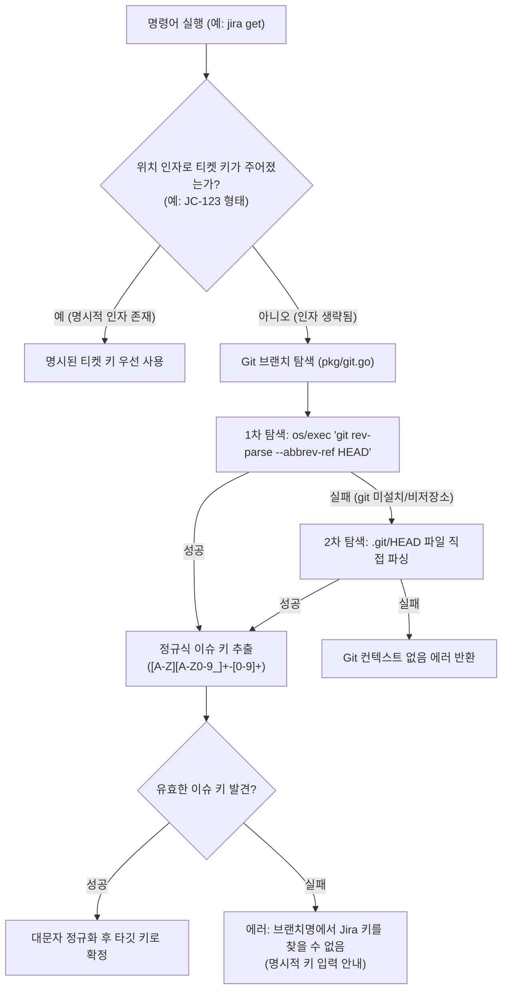

# 📋 [JC-14] Git 브랜치 컨텍스트 자동 바인딩 (Zero-Argument Ticket Binding) 개발 계획

- **티켓 키**: [JC-14](https://joincdream.atlassian.net/browse/JC-14)
- **티켓 요약**: `[Feature] Git 브랜치 컨텍스트 자동 바인딩 (Zero-Argument Ticket Binding)`
- **담당자**: 윤상배 & AI 에이전트
- **상태**: 완료 (Done)
- **라벨**: `AI`, `Architecture`, `Development`

---

## 💡 사용자 및 AI 관점의 핵심 개선 효과 (What Changes?)

| 구분 | ❌ 현재의 불편함 (Before) | ✨ 개선 후 사용자 경험 (After) |
| :--- | :--- | :--- |
| **반복적인 티켓 키 타이핑** | 브랜치(`feature/JC-14-git-binding`)에서 작업 중임에도 `jira get JC-14`, `jira move JC-14 "진행 중"`처럼 매번 키를 입력해야 함 | **`jira get`**, **`jira move "진행 중"`**, **`jira comment "구현 완료"`**처럼 키 인수를 생략해도 현재 작업 티켓을 자동 감지 |
| **AI 에이전트 토큰 및 팝업 절감** | AI 에이전트가 현재 작업 브랜치를 파악한 후에도 CLI 호출 시마다 티켓 키를 인자로 조립해야 하므로 컨텍스트 누수 발생 | 티켓 키 없이 **Zero-Argument**로 직관적 호출 가능, 프롬프트와 툴 호출 복잡도 대폭 감소 |
| **웹 브라우저 연동 편의성** | 브랜치에서 바로 Jira 웹 화면을 띄우려면 키를 입력해야 하고, 생략 시 프로젝트 전체 보드로 이동 | **`jira open`** 단독 실행 시 브랜치에 연결된 티켓 상세 페이지가 즉시 브라우저에서 열림 (브랜치에 키가 없으면 기본 보드로 이동) |
| **일관된 인자 우선순위** | 브랜치가 있어도 다른 티켓을 조회하거나 수정해야 할 때 충돌 우려 | **명시적 키 인수(`jira get JC-3`)가 항상 Git 브랜치 키보다 최우선** 적용되어 유연성 유지 |

---

## 1. 개요 및 배경 (Background & Objectives)

### 1.1 배경: 실무 개발 워크플로우와 Git-Jira 브랜치 네이밍 관례
1. **업계 표준 브랜치 전략**:
   - 대부분의 개발팀은 Jira 티켓 키를 포함하는 Git 브랜치 네이밍 규칙(예: `feature/JC-14-git-binding`, `fix/JC-6-transition-error`, `JC-15_markdown_engine`)을 사용함.
2. **반복 호출 시의 마찰(Friction)**:
   - 이미 특정 이슈 브랜치로 `checkout`하여 코딩 중인 상황에서 `jira get JC-14`, `jira comment JC-14 "..."`, `jira move JC-14 "완료"`를 반복 입력하는 것은 인간 개발자와 AI 에이전트 모두에게 불필요한 인지 부하와 오타 위험을 유발함.
3. **본 프로젝트([JC-14])의 목표**:
   - 외부 라이브러리 추가 없이(Zero-Dependency) Git 컨텍스트를 빠르고 안전하게 탐색하고,
   - CLI 주요 서브커맨드(`get`, `move`, `comment`, `open`, `transitions`, `assign`, `edit`)에서 티켓 키 인수가 생략되었을 때 Git 브랜치에서 자동으로 이슈 키를 추출하여 바인딩하는 무마찰(Frictionless) CLI 경험을 완성함.

---

## 2. 상세 설계 (Detailed Design)

### 2.1 Git 브랜치 탐색 엔진 (`pkg/git.go`)

Go 표준 라이브러리만으로 빠르고 안정적인 Git 브랜치 탐색을 수행합니다.



#### 탐색 구현 세부:
1. **1차: `git rev-parse --abbrev-ref HEAD` (`exec.CommandContext`)**:
   - 서브모듈, 워크트리(Worktree), 복잡한 git 설정에서도 가장 신뢰도 높게 브랜치명을 반환.
   - 타임아웃(1초)을 설정하여 락이나 응답 지연 방지.
2. **2차 Fallback: `.git/HEAD` 직접 파싱 (Zero Subprocess)**:
   - `git` 바이너리가 없는 경량 컨테이너 환경에서도 상위 디렉토리를 탐색하며 `.git/HEAD`를 찾아 `ref: refs/heads/branch-name`을 파싱.
3. **이슈 키 추출 정규식**:
   - `(?i)\b([A-Z][A-Z0-9_]+-\d+)\b`
   - 대소문자 무관 탐색 후 `strings.ToUpper`로 정규화.
   - 예: `feature/jc-14-git` ➔ `JC-14`, `fix/KAN-25_hotfix` ➔ `KAN-25`.

---

### 2.2 서브커맨드별 Zero-Argument 해석 규칙

| 서브커맨드 | 기존 사용법 | Zero-Argument 사용법 | 바인딩 및 인자 해석 로직 |
| :--- | :--- | :--- | :--- |
| **`jira get`** | `jira get <KEY>` | `jira get` | 인자가 없으면 현재 브랜치 키 자동 조회 |
| **`jira move`** | `jira move <KEY> <STATUS>` | `jira move <STATUS>` | 첫 번째 인수가 `KEY` 형태가 아니면 `<STATUS>`로 간주하고 브랜치 키를 타깃으로 적용 |
| **`jira comment`**| `jira comment <KEY> <MSG>` | `jira comment <MSG>` | 첫 번째 인수가 `KEY` 형태가 아니면 `<MSG>`로 간주하고 브랜치 키에 코멘트 등록 |
| **`jira open`** | `jira open [KEY]` | `jira open` | 인자 생략 시 브랜치 키가 있으면 해당 이슈 페이지 열기, 없으면 기존처럼 프로젝트 보드 열기 |
| **`jira transitions`** | `jira transitions <KEY>` | `jira transitions` | 인자 생략 시 브랜치 키의 전이 상태 목록 조회 |
| **`jira assign`** | `jira assign <KEY> <USER>` | `jira assign <USER>` | 인자가 1개이고 `USER`(`me`, `none`, 이메일 등)일 경우 브랜치 키를 대상으로 할당 |
| **`jira edit`** | `jira edit <KEY> [flags]` | `jira edit [flags]` | 키 인수가 생략되고 플래그만 있을 경우 브랜치 키를 대상으로 수정 |

#### 인자 판별 헬퍼 (`IsIssueKeyPattern`):
- 첫 번째 인자가 `^[A-Za-z][A-Za-z0-9_]+-[0-9]+$` 형식인지 검사.
- 일치하면 사용자가 명시한 `KEY`로 처리하고, 일치하지 않으면 브랜치 키를 적용한 뒤 해당 인자를 서브커맨드의 페이로드(`STATUS`, `MESSAGE`, `USER` 등)로 승격.

---

## 3. 변경 파일 목록 및 영향도 분석

| 파일 경로 | 변경 내용 및 역할 |
| :--- | :--- |
| `pkg/git.go` (신규) | • `GetCurrentBranch(ctx) (string, error)`: Git 브랜치명 탐색 함수<br>• `ExtractIssueKeyFromBranch(branch string) (string, bool)`: 브랜치명에서 Jira 키 추출<br>• `ResolveIssueKey(ctx, explicitKey string) (string, error)`: 명시적 키 우선, 생략 시 브랜치 키 자동 감지 통합 헬퍼 |
| `pkg/git_test.go` (신규) | • 브랜치명 정규식 추출 단위 테스트 (`feature/JC-14`, `fix/kan-10`, `main` 등)<br>• git 명령 및 `.git/HEAD` 파싱 Mock 테스트 |
| `internal/app/commands_issue.go` | • `GetCommand`, `MoveCommand`, `CommentCommand`, `TransitionsCommand`, `AssignCommand`, `EditCommand`에 `ResolveIssueKey` 적용 및 가변 인수 재해석 로직 반영 |
| `internal/app/commands_open.go` | • `OpenCommand`: 키 생략 시 브랜치 키 감지 우선 ➔ 미감지 시 프로젝트 보드로 Fallback |
| `internal/app/commands_issue_test.go` | • 브랜치 컨텍스트 바인딩 E2E Mock 테스트 작성 |
| `internal/i18n/locales/{en,ko}.json` | • Git 브랜치 감지 실패 및 미지원 환경에 대한 사용자 친화적 에러 메시지 카탈로그 등록 |
| `.agents/skills/jira/SKILL.md` | • 에이전트 스킬 문서에 Zero-Argument CLI 사용 가이드 반영 |
| `knowledge/commands-and-routing.md` | • OKF 문서에 Git Context Binding 사양 및 라우팅 규칙 동기화 |

---

## 4. 단계별 구현 계획 (Implementation Steps)

### Phase 1. Git 브랜치 탐색 및 키 추출 코어 엔진 (`pkg/git.go`)
- [x] `pkg/git.go` 작성:
  - `IsIssueKey(str string) bool` 정규식 검사기
  - `GetCurrentBranch(ctx context.Context) (string, error)` (1차: `exec.Command`, 2차: `.git/HEAD` 파일 탐색)
  - `ExtractIssueKey(branch string) (string, bool)`
  - `ResolveIssueKey(ctx context.Context, explicitKey string) (string, error)`
- [x] `pkg/git_test.go` 작성 및 다양한 브랜치명 케이스 검증

### Phase 2. 이슈 명령어 인자 재해석 및 바인딩 (`internal/app/`)
- [x] `GetCommand`: 인자 0개일 때 브랜치 키 조회
- [x] `TransitionsCommand`: 인자 0개일 때 브랜치 키 조회
- [x] `MoveCommand`: 인자 1개(`jira move "진행 중"`)일 때 브랜치 키 + 상태 전이
- [x] `CommentCommand`: 인자 1개(`jira comment "메시지"`)일 때 브랜치 키 + 코멘트 등록
- [x] `AssignCommand`: 인자 1개(`jira assign me`)일 때 브랜치 키 + 담당자 할당
- [x] `EditCommand`: 키 인수 생략 시 플래그만으로 브랜치 키 수정
- [x] `OpenCommand`: 인자 생략 시 브랜치 키 웹페이지 열기

### Phase 3. 다국어 메시지 및 에러 가이드 강화
- [x] `internal/i18n/locales/{en,ko}.json`:
  - 브랜치에 이슈 키가 없을 때의 명확한 안내 ("현재 Git 브랜치('%s')에서 Jira 이슈 키를 감지하지 못했습니다. 키를 직접 지정해 주세요: jira %s <KEY> ...")
  - 비-Git 저장소 안내 문구

### Phase 4. 테스트 검증 및 빌드
- [x] `pkg/git_test.go` 및 `internal/app/commands_issue_test.go` 단위/통합 테스트 (100% Pass)
- [x] 실제 git 저장소 환경에서 브랜치 전환(`git checkout -b feature/JC-14-...`) 후 무인자 CLI 테스트
- [x] `make install` 배포 및 회귀 테스트

### Phase 5. 지식 베이스 동기화 및 마감
- [x] [knowledge/commands-and-routing.md](knowledge/commands-and-routing.md) 및 [knowledge/log.md](knowledge/log.md) OKF 문서 갱신
- [x] `.agents/skills/jira/SKILL.md` 및 내장 템플릿 갱신
- [x] `task/JC-14.md` 진행 상태 업데이트

---

## 5. 검증 및 완료 기준 (Acceptance Criteria)

1. **인자 우선순위 검증**:
   - `feature/JC-14-test` 브랜치에서 `jira get JC-3` 실행 시 브랜치 키가 아닌 `JC-3`을 조회해야 함.
2. **Zero-Argument 동작 검증**:
   - `feature/JC-14-test` 브랜치에서:
     - `jira get` ➔ `JC-14` 상세 정보 출력
     - `jira transitions` ➔ `JC-14` 전이 가능 상태 출력
     - `jira move "진행 중"` ➔ `JC-14` 상태 전이
     - `jira comment "작업 완료"` ➔ `JC-14`에 코멘트 등록
     - `jira assign me` ➔ `JC-14` 담당자 배정
     - `jira open` ➔ `JC-14` 이슈 상세 URL 오픈
3. **에러 가이드 검증**:
   - `main` 또는 `master` 등 티켓 키가 없는 브랜치에서 `jira get` 실행 시 친절한 에러 메시지와 함께 종료 코드 1 반환.
4. **외부 의존성 제로**:
   - 서드파티 라이브러리 추가 없음 (Go 표준 라이브러리만 사용).
5. **테스트 커버리지**:
   - `go test -v ./...` 100% Pass.

---

## 6. 사용자 수동 테스트 가이드 (Manual Testing Guide)

```bash
# 1. 테스트용 브랜치 생성 및 체크아웃
git checkout -b feature/JC-14-git-binding

# 2. 키 인수 없이 티켓 조회 (현재 브랜치의 JC-14가 조회되어야 함)
jira get --md

# 3. 키 인수 없이 전이 상태 확인
jira transitions

# 4. 키 인수 없이 코멘트 등록
jira comment "Git 브랜치 컨텍스트 자동 바인딩 테스트입니다."

# 5. 키 인수 없이 상태를 진행 중으로 전이
jira move "진행 중"

# 6. 명시적 키 인수가 주어지면 브랜치 무시하고 명시된 키 조회 확인
jira get JC-15 --md
```
