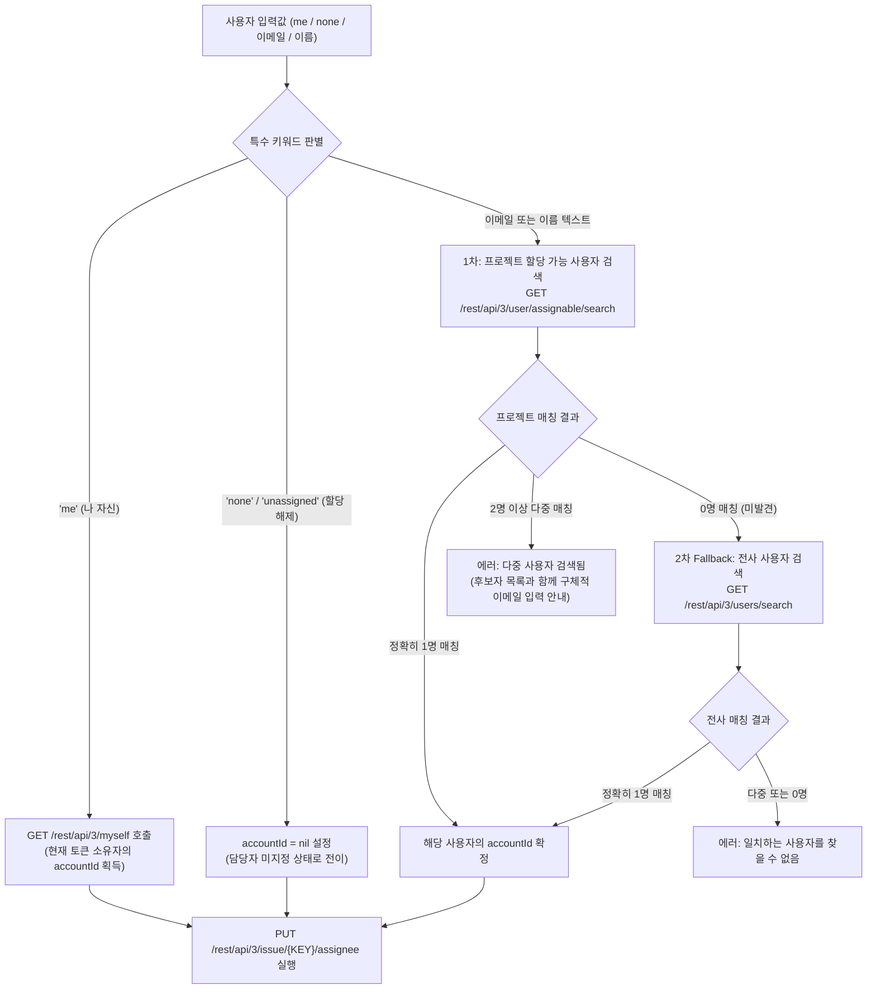

# 📋 [JC-16] 사용자(User) 검색, 담당자(Assignee) 할당 및 필터링 기능 구현 개발 계획

- **티켓 키**: [JC-16](https://joincdream.atlassian.net/browse/JC-16)
- **티켓 요약**: `[Feature] 사용자(User) 검색, 담당자(Assignee) 할당 및 필터링 기능 구현`
- **담당자**: 윤상배 & AI 에이전트
- **상태**: 완료 (Done)
- **라벨**: `Architecture`, `Development`, `Composability`

---

## 💡 사용자 및 AI 관점의 핵심 개선 효과 (What Changes?)

| 구분 | ❌ 현재의 불편함 (Before) | ✨ 개선 후 사용자 경험 (After) |
| :--- | :--- | :--- |
| **티켓 담당자 할당 부재** | CLI에 담당자 지정/변경 기능이 없어 티켓 배정 시 무거운 Jira 웹 브라우저를 열어 수동 클릭해야 함 | **`jira assign <KEY> <USER>`** 및 **`jira edit <KEY> --assignee <USER>`**로 터미널에서 즉시 1초 만에 담당자 할당 |
| **티켓 생성 시 담당자 누락** | 티켓 생성(`jira create`) 시 담당자를 넣을 수 없어 생성 후 웹에서 다시 배정해야 함 | **`jira create "제목" -d "설명" --assignee me`**로 생성과 동시에 원스톱 배정 |
| **Jira Cloud 식별자 복잡성** | Jira Cloud REST API v3는 난해한 `accountId`(예: `5b10a284...`)를 요구하여 사용자가 API를 다루기 어려움 | 사용자가 **`me`**, **`none`**, **이메일**(`joinc.dream@gmail.com`), 또는 **이름**(`윤상배`)을 입력하면 CLI가 내부에서 **자동 유저 매핑(Auto-Resolution)** 완결 |
| **전사 조직원/팀원 탐색 부재** | Jira에 등록된 팀원의 계정 정보나 이메일을 터미널에서 확인할 방법이 없음 | **`jira users [query]`** 명령어로 **전사 모든 팀원(기본)** 또는 **프로젝트 배정 가능 팀원(`--assignable`)** 목록을 즉시 조회 |
| **내 업무 필터링 편의성** | 내 티켓만 보려면 `jira list --assignee me`를 매번 타이핑해야 함 | **`jira list --mine`** 직관적 단축 플래그 지원 |

---

## 1. 개요 및 배경 (Background & Objectives)

### 1.1 배경: Jira Cloud REST API v3의 `accountId` 체계와 매핑 장벽
1. **Atlassian GDPR 개인정보보호 정책과 `accountId` 강제**:
   - Atlassian Jira Cloud REST API v3에서는 기존의 `username`, `key` 파라미터가 완전히 제거되었으며, 모든 사용자 식별 및 필드 할당은 난해한 128비트 해시 형태의 `accountId`를 통해서만 수행해야 함.
   - 그러나 인간 개발자와 AI 에이전트는 `accountId`를 기억하거나 알지 못하며, 주로 `이메일`, `이름(DisplayName)`, 또는 `me(나 자신)` 키워드를 사용함.
2. **에이전트 자율 업무 흐름의 단절**:
   - AI 에이전트가 Jira 티켓을 조회하고 코드를 구현한 뒤, 작업자를 자신이나 페어 프로그래머에게 할당하려 해도 CLI에 담당자 변경 기능이 없어 작업 흐름이 끊기고 웹 UI 콘솔로 이탈해야 하는 심각한 병목 발생.
3. **본 프로젝트([JC-16])의 목표**:
   - Zero-Dependency 원칙을 엄수하면서, 인간과 AI 에이전트 모두에게 직관적인 **사용자 검색(`users`), 담당자 할당(`assign`), 티켓 생성/수정 시 담당자 지정(`--assignee`), 내 작업 필터링(`--mine`)** 기능을 완성함.

---

## 2. 상세 설계 (Detailed Design)

### 2.1 사용자 해석 및 매핑 엔진 (User Auto-Resolution Engine)

CLI의 모든 `--assignee` 및 `jira assign` 인자는 아래의 4단계 매핑 파이프라인을 거쳐 Jira API가 요구하는 `accountId`로 자동 변환됩니다.



1. **`me` 키워드**:
   - Jira REST API `GET /rest/api/3/myself`를 호출하여 현재 인증 토큰의 `accountId`를 0.05초 만에 획득.
2. **`none` 또는 `unassigned` 키워드**:
   - 티켓 담당자를 할당 해제할 때 사용. 페이로드로 `{"accountId": null}`을 전송.
3. **이메일 또는 이름(일반 텍스트) Auto-Resolution**:
   - **1차 안전 검색**: 프로젝트 할당 가능 사용자(`user/assignable/search`)에서 먼저 조회.
   - **2차 Fallback 검색**: 프로젝트 권한 설정 지연 등으로 1차에서 찾지 못하더라도, 전사 사용자(`users/search`)에서 유저를 찾아내어 유연하게 매핑 완결.
   - 동명이인 등으로 다중 매칭 시 사용자에게 이메일 명시를 유도하는 Actionable Error 출력.

---

### 2.2 CLI 서브커맨드 및 플래그 인터페이스

#### 1) 사용자 검색 (`jira users [flags] [query]`)
* **사용법**:
  ```bash
  # 1. 기본 동작: Jira 인스턴스 전체 팀원/조직원 조회 (Global User Directory)
  jira users
  jira users "윤상배"
  jira users joinc.dream@gmail.com
  
  # 2. 프로젝트 한정 조회: 현재 프로젝트에 티켓 할당이 가능한 팀원만 조회
  jira users --assignable
  jira users -p JC --assignable
  
  # 3. 비활성(퇴사/정지) 사용자 포함 조회
  jira users --include-inactive
  
  # 4. 머신 리더블 출력
  jira users --md
  jira users --json
  ```
* **출력 항목**: `Account ID`, `Display Name`, `Email`, `Active` 여부

#### 2) 티켓 담당자 즉시 할당 (`jira assign <KEY> <USER>`)
* **사용법**:
  ```bash
  # 나 자신에게 할당
  jira assign JC-16 me
  
  # 이메일로 팀원에게 할당
  jira assign JC-16 joinc.dream@gmail.com
  
  # 이름으로 팀원에게 할당
  jira assign JC-16 "윤상배"
  
  # 담당자 할당 해제
  jira assign JC-16 none
  ```
* **성공 메시지**: `✅ [JC-16] 담당자가 '윤상배 (joinc.dream@gmail.com)'(으)로 변경되었습니다.`

#### 3) 티켓 수정 시 담당자 변경 (`jira edit <KEY> --assignee <USER>`)
* **사용법**:
  ```bash
  jira edit JC-16 --assignee me
  jira edit JC-16 -a joinc.dream@gmail.com --due 2026-10-30
  jira edit JC-16 --assignee none
  ```

#### 4) 티켓 생성 시 담당자 지정 (`jira create <SUMMARY> --assignee <USER>`)
* **사용법**:
  ```bash
  jira create "신규 기능 개발" -d "상세 요구사항" --assignee me
  jira create "버그 픽스" -d "원인 분석" -a joinc.dream@gmail.com -l "Bug,QA"
  ```

#### 5) 내 티켓 단축 필터 (`jira list --mine`)
* **사용법**:
  ```bash
  # jira list --assignee me 와 완전히 동일한 직교적 단축 문법
  jira list --mine
  jira list --mine --detail --md
  ```

---

### 2.3 Jira Cloud REST API v3 엔드포인트 명세

| 기능 | HTTP Method & Endpoint | Request Body / Query Params | Response |
| :--- | :--- | :--- | :--- |
| **현재 사용자 조회** | `GET /rest/api/3/myself` | - | `200 OK` (User JSON) |
| **전사 전체 사용자 검색** | `GET /rest/api/3/users/search` | `?query={text}&includeInactive={bool}` | `200 OK` (User[] JSON) |
| **할당 가능 사용자 검색** | `GET /rest/api/3/user/assignable/search` | `?project={key}&query={text}` | `200 OK` (User[] JSON) |
| **티켓 담당자 할당** | `PUT /rest/api/3/issue/{key}/assignee` | `{"accountId": "<id>"` 또는 `null}` | `204 No Content` |
| **티켓 생성 시 할당** | `POST /rest/api/3/issue` | `fields.assignee = {"id": "<accountId>"}` | `201 Created` |
| **티켓 수정 시 할당** | `PUT /rest/api/3/issue/{key}` | `fields.assignee = {"id": "<accountId>"}` | `204 No Content` |

---

## 3. 영향 범위 분석 (Impact Analysis)

| 파일/모듈 | 변경 내용 및 역할 |
| :--- | :--- |
| `pkg/types.go` | • `UserRef{ID string}` 구조체 정의 (생성/수정용 DTO)<br>• `CreateIssueFields` 및 `UpdateIssueFields`에 `Assignee *UserRef` 필드 추가 |
| `pkg/client.go` | • `GetMyself(ctx)`: 현재 인증된 사용자 정보 조회 API 구현<br>• `SearchGlobalUsers(ctx, query, includeInactive)`: 전사 사용자 검색 API<br>• `SearchAssignableUsers(ctx, projectKey, query)`: 프로젝트 할당 가능 사용자 검색<br>• `AssignIssue(ctx, key, accountID)`: `PUT /rest/api/3/issue/{key}/assignee` 호출<br>• `ResolveUserAccountID(ctx, projectKey, userQuery)`: `me`, `none`, 프로젝트 1차 ➔ 전사 2차 Fallback 매핑 헬퍼 |
| `internal/app/commands_user.go` (신규) | • `UsersCommand`: `jira users [flags] [query]` 서브커맨드 구현 (전사 기본, `--assignable`, `--include-inactive`, MD, JSON 지원) |
| `internal/app/commands_issue.go` | • `AssignCommand`: `jira assign <KEY> <USER>` 서브커맨드 구현<br>• `EditCommand`: `--assignee`, `-a` 플래그 추가 및 `ResolveUserAccountID` 연동<br>• `CreateCommand`: `--assignee`, `-a` 플래그 추가 및 연동<br>• `ListCommand`: `--mine` 플래그 파싱 및 `assignee=me` 바인딩 |
| `internal/app/app.go` | • `NewUsersCommand`, `NewAssignCommand` 명령어 라우터 등록 및 도움말 갱신 |
| `pkg/format.go` | • `PrintUsersTable`, `PrintUsersMarkdown`, `PrintUsersJSON` 포맷터 구현 |
| `internal/i18n/locales/{en,ko}.json` | • `users`, `assign` 서브커맨드 및 플래그 다국어 메시지 카탈로그 등록 |
| `internal/templates/` & `.agents/skills/jira/SKILL.md` | • 에이전트 스킬 문서에 `jira assign` 및 `--assignee` 명령어 명세 반영 |
| `knowledge/commands-and-routing.md` | • OKF 지식 베이스 서브커맨드 및 플래그 명세 동기화 |

---

## 4. 단계별 구현 계획 (Implementation Steps)

### Phase 1. 도메인 모델 및 API 클라이언트 구현 (`pkg/`)
- [x] `pkg/types.go`: `UserRef` 구조체 및 DTO 필드 확장
- [x] `pkg/client.go`: `GetMyself`, `SearchGlobalUsers`, `SearchAssignableUsers`, `AssignIssue` API 구현
- [x] `pkg/client.go`: `ResolveUserAccountID` 사용자 자동 매핑(프로젝트 1차 ➔ 전사 2차 Fallback) 헬퍼 함수 구현
- [x] `pkg/client_test.go`: Mock 서버 기반 사용자 조회, 검색, 할당 단위 테스트 작성

### Phase 2. 머신 리더블 포맷터 엔진 확장 (`pkg/format.go`)
- [x] `PrintUsersTable`: 터미널 사용자 목록 표 포맷팅
- [x] `PrintUsersMarkdown`: GFM 파이프 테이블 기반 사용자 목록 포맷팅
- [x] `PrintUsersJSON`: 표준 JSON 직렬화
- [x] `pkg/format_test.go`: 포맷터 단위 테스트 작성

### Phase 3. CLI 서브커맨드 및 플래그 연동 (`internal/app/`)
- [x] `internal/app/commands_user.go`: `UsersCommand` (`jira users [flags] [query]`) 구현
- [x] `internal/app/commands_issue.go`:
  - [x] `AssignCommand` (`jira assign <KEY> <USER>`) 구현
  - [x] `EditCommand`: `--assignee`, `-a` 플래그 바인딩 및 수정 로직 연동
  - [x] `CreateCommand`: `--assignee`, `-a` 플래그 바인딩 및 생성 페이로드 연동
  - [x] `ListCommand`: `--mine` 플래그 추가
- [x] `internal/app/app.go`: 신규 명령어 등록

### Phase 4. 다국어 지원 및 에이전트 SKILL 동기화
- [x] `internal/i18n/locales/{en,ko}.json`: 도움말, 사용법, 에러 및 성공 안내문 등록
- [x] `internal/templates/` (`skill.md`, `cursor.mdc`, `claude.md`) 및 `.agents/skills/jira/SKILL.md`: `jira assign` 레퍼런스 반영

### Phase 5. 종합 검증 및 문서화
- [x] `go test -v ./...` 전체 테스트 패스 검증 (100% Pass)
- [x] `make install` 로컬 바이너리 배포 및 CLI 동작 검증
- [x] [knowledge/commands-and-routing.md](knowledge/commands-and-routing.md) 및 [knowledge/log.md](knowledge/log.md) OKF 문서 동기화

---

## 5. 검증 및 완료 기준 (Acceptance Criteria)

1. **단위 및 Mock E2E 테스트 통과**: `go test -v ./...` 100% Pass.
2. **사용자 검색 검증**:
   - `jira users`: 전사 모든 팀원 목록이 터미널, 마크다운, JSON으로 정상 출력되는지 확인.
   - `jira users --assignable`: 프로젝트 할당 가능 사용자만 필터링되어 출력되는지 확인.
   - `jira users "query"`: 필터링 검색 동작 확인.
3. **담당자 할당 검증**:
   - `jira assign <KEY> me`: 현재 로그인 사용자의 `accountId`를 조회하여 티켓에 정상 할당되는지 확인.
   - `jira assign <KEY> "joinc.dream@gmail.com"`: 이메일 기반 자동 매핑 후 할당 확인.
   - `jira assign <KEY> none`: 담당자가 미지정(`null`) 상태로 정상 변경되는지 확인.
4. **티켓 생성/수정/조회 연동 검증**:
   - `jira create "제목" -d "설명" --assignee me`: 생성 시 담당자가 배정되어 있는지 확인.
   - `jira edit <KEY> --assignee <USER>`: 수정 시 정상 반영되는지 확인.
   - `jira list --mine`: 내 티켓만 정확히 필터링되어 출력되는지 확인.
5. **비기능 요건**:
   - Go 표준 라이브러리만 사용 (Zero-Dependency).

---

## 6. 사용자 수동 테스트 가이드 (Manual Testing Guide)

```bash
# 1. 사용자 검색 및 내 계정 정보 확인
jira users
jira users --assignable
jira users "joinc.dream@gmail.com" --md

# 2. 티켓에 나 자신(me) 할당
jira assign JC-16 me

# 3. 티켓 상세에서 담당자 확인
jira get JC-16 --md

# 4. 내 작업 목록 필터링 확인
jira list --mine --md

# 5. 티켓 담당자 할당 해제 (none)
jira assign JC-16 none
jira get JC-16 --md

# 6. 이메일 지정으로 다시 할당
jira assign JC-16 joinc.dream@gmail.com
```

---

## 7. AI 에이전트 실전 협업 시나리오 (Agent-in-the-Loop)

* **사용자 프롬프트**:
  > *"모든 Jira Ticket에 저를 할당해 주세요. 저는 joinc.dream@gmail.com 입니다."*
* **AI 에이전트의 내부 동작**:
  1. `jira list --md` 1회 호출로 열린 티켓 키(`JC-16`, `JC-15`, `JC-14`, `JC-7`, `JC-6`) 목록 추출.
  2. 각 티켓에 대해 `jira assign <KEY> joinc.dream@gmail.com` 순차 실행.
  3. 완료 후 전체 티켓의 변경 결과를 요약하여 사용자에게 최종 보고.
* **검증 포인트**:
  - 웹 브라우저를 열지 않고 터미널에서 전체 티켓에 대한 사용자 할당이 10초 이내에 자동 완료되는가?
