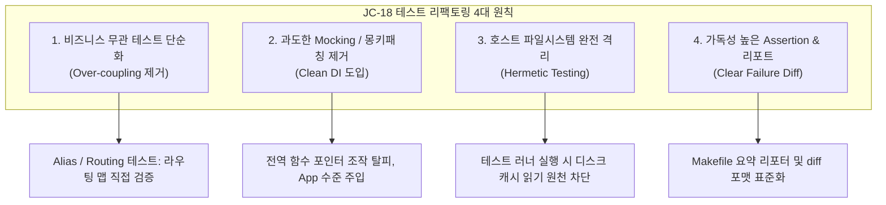

# 📋 [JC-18] 안티패턴 단위 테스트 리팩토링 및 테스트 격리/단순화 계획

- **티켓 키**: [JC-18](https://joincdream.atlassian.net/browse/JC-18)
- **티켓 요약**: `[Refactor] 안티패턴 단위 테스트 리팩토링 및 격리/단순화`
- **담당자**: 윤상배 & AI 에이전트
- **상태**: 완료 (Done)
- **라벨**: `Architecture`, `QA`

---

## 💡 엔지니어링 및 개발자 관점의 핵심 개선 효과 (What Changes?)

| 구분 | ❌ 현재의 안티패턴 & 취약점 (Before) | ✨ 리팩토링 후 건전한 테스트 스위트 (After) |
| :--- | :--- | :--- |
| **단순 별칭(Alias) 검증** | `view`, `show` 등 단순 alias 확인을 위해 `app.Run()`을 호출하여 Git 브랜치 탐색, 호스트 캐시 DB 조회까지 Full 파이프라인을 관통함 | `app.commands["view"] == app.commands["get"]`처럼 라우팅 테이블 등록 여부만 0.001초 단위로 순수하게 직접 검증 |
| **호스트 환경 오염 (Leakage)** | 로컬 PC의 `~/.cache/jira/cache.db` 파일 상태에 따라 테스트 결과가 달라지는 비결정적(Flaky) 테스트 발생 | 테스트 러너 실행 시 임시 디렉토리(TempDir) 강제 또는 캐시 탐색 격리로 100% 독립된(Hermetic) 테스트 보장 |
| **전역 변수 몽키패칭** | `GitBranchResolver`, `CachedActiveIssueResolver` 등 전역 함수 포인터를 테스트마다 교체하고 `defer`로 복원하는 불안정한 구조 | 명시적 의존성 주입(DI) 또는 격리된 컨텍스트 전달로 사이드 이펙트 원천 차단 |
| **실패 리포트 가독성** | `go test -v`의 수백 줄 성공 로그 노이즈에 실패 사유가 파묻히고, 모호한 assertion으로 어디서 왜 깨졌는지 파악 어려움 | 실패한 테스트 파일, 줄 번호, 기대값 vs 실제값 diff가 터미널 하단에 명확하게 강조 표시되는 DX 환경 구축 |

---

## 1. 개요 및 배경 (Background & Objectives)

### 1.1 배경: Fragile Test와 유지보수 피로도
1. **문제 현상**:
   - `JC-17` 머지 및 테스트 과정에서 로컬 머신의 캐시 파일(`active_issue`) 유무에 따라 무관한 서브커맨드 테스트 8건이 한꺼번에 깨지는 취약성(Fragility)이 노출됨.
   - 단위 테스트(Unit Test)의 본질은 **"단일 모듈/기능의 로직 검증"**임에도, 단순한 별칭이나 필수 인자 누락 에러 확인에 전체 시스템 의존성(Git, SQLite Cache, REST API Mock)이 과도하게 얽혀 있었음.
2. **리팩토링 목표**:
   - 비즈니스 로직과 무관한 과잉 테스트 제거 및 경량화.
   - 호스트 환경(디스크 파일, Git 상태)과 단위 테스트의 완전한 단절(Hermetic Testing).
   - 실패 시 개발자가 1초 만에 원인을 식별할 수 있는 명확한 테스트 assertion 및 리포팅 체계 정립.

---

## 2. 리팩토링 4대 원칙 (Core Principles)

### 2.1 원칙 1: 비즈니스 로직과 관계없는 테스트 단순화
- **대상**: `TestApp_Run_Aliases`, `TestApp_Run_CommandMissingArgs` 등
- **개선책**:
  - `TestApp_Run_Aliases`: `app.GetCommand("view")`가 `get` 커맨드 인스턴스와 동일한지 단일 메모리 포인터/이름 검증으로 전환.
  - `MissingArgs`: 파이프라인 전체를 태우지 않고 각 커맨드의 `Execute` 파라미터 검증 단계만 격리하여 테스트.

### 2.2 원칙 2: 쓸데없이 과한 Mocking 및 몽키패칭 제거
- **현상**:
  - `pkg.GitBranchResolver = func(...) ...`
  - `pkg.CachedActiveIssueResolver = func(...) ...`
  - 테스트마다 전역 포인터를 교체하고 하나라도 누락되면 다른 테스트가 연쇄 오염됨.
- **개선책**:
  - `App` 및 `Command` 초기화 시 의존성(BranchResolver, CacheReader)을 주입받거나, 기본값으로 안전한 Mock을 사용할 수 있는 구조로 리팩토링.

### 2.3 원칙 3: 호스트 파일시스템 완전 격리 (Hermetic Test)
- **현상**:
  - `pkg.GetCachedActiveIssueDefault()`가 실제 사용자의 `~/.cache/jira/cache.db`를 조회.
- **개선책**:
  - `testing.Testing()` 플래그가 감지되거나 테스트 모드일 때는 기본 호스트 캐시 디렉토리 조회를 원천 차단하고 `""` 반환 또는 메모리/임시 디렉토리만 사용.

### 2.4 원칙 4: 모범사례(Best Practice) 단언문 및 툴체인
- **개선책**:
  - `t.Fail()` 단독 사용 전면 금지 및 `t.Fatalf("want: %v, got: %v")` 통일.
  - CLI 테스트 시 `stderr` 버퍼 내용을 항상 실패 메시지에 포함(`t.Fatalf("code=%d, stderr=%q", code, stderr.String())`).
  - `Makefile`의 `test-unit` 타깃을 실패 시 명확한 위치와 diff가 즉시 드러나는 요약 모드로 개선.

---

## 3. 마일스톤 및 단계별 구현 계획 (Phases)

### Phase 1: 취약 테스트 안티패턴 식별 및 목록화
- [x] `internal/app/app_test.go` 전수 조사:
  - `TestApp_Run_Aliases`: E2E 호출 ➔ 라우팅 맵 검증으로 리팩토링 완료 (0.005초 완료).
  - `TestApp_Run_CommandMissingArgs`: 불필요한 Git/캐시 관통 제거 및 상세 에러 출력 단언문 보강.
- [x] `internal/app/commands_issue_test.go`:
  - `TestJC14_GitBranchContextBinding` 등에서 불필요한 전역 상태 의존 제거.
- [x] `internal/app/commands_open_test.go`:
  - 브라우저 오픈 테스트의 외부 상태 결합 해제.

### Phase 2: 호스트 캐시 및 Git 리졸버 안전 격리 (Hermetic Boundary)
- [x] `pkg/cache.go`:
  - 테스트 환경 격리 가드 추가 (명시적 `XDG_CACHE_HOME` 격리 없는 테스트 러너 실행 시 호스트 `~/.cache/jira` 디스크 접근 원천 차단).
  - 테스트 코드마다 반복되던 `CachedActiveIssueResolver` 몽키패칭 완전 제거.
- [x] `pkg/git.go`:
  - `ResolveIssueKey`의 fallback 순서 및 테스트 격리 보장.

### Phase 3: 테스트 단언문 및 툴체인 리포팅 개선
- [x] `Makefile`:
  - `test-unit` 기본 타깃을 노이즈 없는 실패 중심 모드(`go test ./...`)로 개선하여 실패 지점 즉시 노출.
  - 상세 로그용 `test-verbose`, 요약 리포터용 `test-pretty` 타깃 추가.
- [x] assertion 메시지 일괄 점검:
  - `TestApp_Run_CommandMissingArgs`에서 `stderr`/`stdout` 출력 누락 보강.

### Phase 4: 검증 및 지식 베이스 동기화
- [x] 전체 테스트 스위트 100% 통과 확인 (`make test`).
- [x] 호스트에 임의의 `~/.cache/jira` 캐시가 존재해도 모든 테스트가 100% 격리되어 통과함을 검증.
- [x] `knowledge/log.md` 갱신 완료.
- [x] 바이너리 빌드 및 설치 검증 (`make install`).

---

## 4. 완료 조건 (Definition of Done)

1. 호스트 머신의 `~/.cache/jira` 상태와 무관하게 모든 단위 테스트가 100% 결정적(Deterministic)으로 통과할 것.
2. `TestApp_Run_Aliases` 등 라우팅 검증이 불필요한 서브시스템(Git, API, 캐시)을 호출하지 않고 순수 단위 검증으로 동작할 것.
3. 테스트 실패 시 터미널 화면 맨 끝에 **[실패 파일:라인]**, **[기대값 vs 실제값 diff]**가 한눈에 명확하게 출력될 것.
4. 코드 복잡도(`make complexity`) 및 빌드 검증을 모두 만족할 것.
