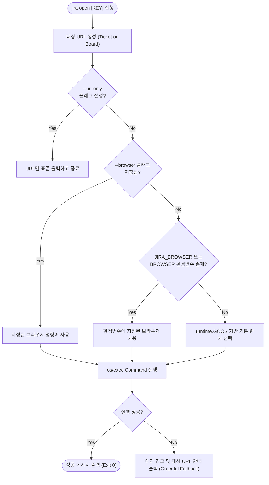

# 📋 [JC-3] 웹 브라우저 핸드오프 기능 구현 (jira open / browse) 개발 계획

- **티켓 키**: [JC-3](https://joincdream.atlassian.net/browse/JC-3)
- **티켓 요약**: `[Feature] 웹 브라우저 핸드오프 기능 구현 (jira open / browse)`
- **담당자**: AI 에이전트 & 윤상배
- **상태**: 완료 (Done)
- **라벨**: `Architecture`, `Development`

---

## 💡 사용자 관점의 핵심 개선 효과 (What Changes for Users?)

| 구분 | ❌ 현재의 불편함 (Before) | ✨ 개선 후 사용자 경험 (After) |
| :--- | :--- | :--- |
| **이슈 웹 상세 조회** | 터미널에서 티켓 확인 후 첨부파일, 이미지, 시각적 다이어그램을 보려면 브라우저를 직접 띄우고 도메인과 티켓 URL을 수동으로 조합해 접속해야 함 | **`jira open <KEY>`** (또는 `jira browse <KEY>`) 명령어 하나로 **기본 웹 브라우저에서 해당 이슈 페이지 즉시 오픈** |
| **프로젝트 보드 조망** | 전체 칸반/스크럼 보드를 보려면 브라우저 북마크를 찾거나 복잡한 Jira 소프트웨어 보드 URL을 찾아 들어가야 함 | **`jira open`**만 입력하면 현재 설정된 프로젝트의 **활성 보드(또는 프로젝트 메인) 화면으로 즉시 핸드오프** |
| **커스텀 브라우저 실행** | 개발용 프로필 브라우저(예: Chrome 개발자 계정)나 특정 브라우저로 열고 싶어도 OS 기본 브라우저만 사용해야 함 | **`--browser <cmd>`** 플래그 및 **`JIRA_BROWSER` / `BROWSER` 환경 변수** 지원으로 원하는 브라우저 즉시 지정 가능 |
| **원격 서버/헤드리스 환경** | SSH 접속 또는 GUI 디스플레이가 없는 환경에서 명령어 실행 시 침묵하거나 오류 발생 | 브라우저 실행 실패 또는 미지원 환경 감지 시 **클릭 가능한 대상 URL을 터미널에 친절히 출력(Graceful Fallback)** |

---

## 1. 개요 및 배경 (Background & Objectives)

### 1.1 배경 및 목적
1. **터미널-웹 매끄러운 전환(Seamless Hand-off)**:
   - 터미널 중심의 CLI 워크플로를 유지하면서도, Jira 특유의 복잡한 시각적 UI(칸반 보드 드래그 앤 드롭, 첨부 이미지/동영상 확인, 리치 텍스트 서식 검토)가 필요한 순간 즉시 브라우저로 전환할 수 있는 직관적인 핸드오프 기능이 요구됨.
2. **Zero-Dependency 원칙 고수**:
   - 외부 브라우저 오픈 패키지를 도입하지 않고, Go 표준 라이브러리(`os/exec`, `runtime`)만을 활용하여 초경량 바이너리와 안전성을 보장함.
3. **크로스 플랫폼 및 유연한 런처 지원**:
   - Linux(`xdg-open`), macOS(`open`), Windows(`cmd /c start` 또는 `rundll32`) 등 주요 운영체제를 모두 지원하며, 사용자가 원하는 커스텀 런처를 플래그와 환경 변수로 제어할 수 있어야 함.

---

## 2. 영향 범위 분석 (Impact Analysis)

| 파일/모듈 | 변경 내용 및 역할 |
| :--- | :--- |
| `internal/app/commands_open.go` (신규) | • `OpenCommand`: `jira open` / `browse` 명령어 구현 • 브라우저 런처 감지 및 프로세스 실행 로직 • 티켓 키 유무에 따른 URL 라우팅 |
| `internal/app/commands_open_test.go` (신규) | • OS별 실행 커맨드 생성 로직 단위 테스트 • URL 조립 및 플래그/환경 변수 우선순위 테스트 |
| `internal/app/app.go` | • `NewOpenCommand(a.clientProvider)` 등록 및 사용법(`PrintUsage`) 도움말 갱신 |
| `internal/i18n/locales/{en,ko}.json` | • `open` 명령어 관련 다국어 메시지 등록 (안내 문구, 플래그 설명, 에러 및 폴백 메시지) |
| `docs/03_FEATURES_AND_COMMANDS.md` | • `jira open` / `jira browse` 사용 가이드 및 CLI 옵션 문서화 |
| `knowledge/commands-and-routing.md` | • OKF 지식 베이스 명령어 목록 및 라우팅 테이블 갱신 |
| `knowledge/log.md` | • 작업 내역 및 검증 결과 기록 |

---

## 3. 상세 설계 (Detailed Design)

### 3.1 명령어 인터페이스 및 플래그

- **명령어**: `jira open [KEY] [flags]`
- **별칭(Aliases)**: `browse`
- **인자**:
  - `KEY` (선택): Jira 티켓 키 (예: `JC-3`, `KAN-10`). 미지정 시 현재 프로필의 프로젝트 보드/개요 페이지 오픈.
- **플래그**:
  - `--browser <cmd>`: 사용할 브라우저 실행 명령어/바이너리 지정.
  - `--url-only`: 브라우저를 실행하지 않고 생성된 대상 웹 URL만 stdout에 출력 (스크립트 및 에이전트 연동용).

### 3.2 URL 결정 규칙

1. **단일 티켓 모드 (`jira open <KEY>`)**:
   - 티켓 키 유효성 확인 (대소문자 자동 대문자화: `strings.ToUpper(key)`).
   - URL: `<InstanceURL>/browse/<KEY>`
2. **프로젝트 보드 모드 (`jira open`)**:
   - 현재 활성 프로필의 `ProjectKey` 사용 (기본값: `KAN`).
   - URL: `<InstanceURL>/browse/<ProjectKey>`
   - **설계 근거**: Jira Cloud에서 `/jira/software/projects/<KEY>/boards`는 고유 `boardId`(예: `/boards/34`)가 누락되면 404가 발생함. 반면 `/browse/<ProjectKey>`로 접근하면 Jira 웹 서버가 해당 프로젝트의 대표 활성 보드로 자동 리다이렉트하므로, CLI에서 사전 API 호출 오버헤드 없이 즉시 브라우저를 오픈할 수 있음.

### 3.3 브라우저 실행기 및 우선순위 (Launcher Resolution)

#### OS별 기본 런처 매핑:
- **macOS (`darwin`)**: `open <url>`
- **Linux / BSD (`linux`, `freebsd` 등)**: `xdg-open <url>`
- **Windows (`windows`)**: `cmd /c start <url>` 또는 `rundll32 url.dll,FileProtocolHandler <url>`

---

## 4. 단계별 구현 계획 (Implementation Steps)

### Phase 1. `OpenCommand` 인터페이스 및 런처 유틸리티 구현
- [x] `internal/app/commands_open.go` 작성:
  - `OpenCommand` 구조체 및 `command.go` 인터페이스 구현 (`Name`, `Description`, `Aliases`, `Run`).
  - OS별 표준 브라우저 오픈 커맨드 빌더 및 환경 변수 처리 함수 구현.
  - 헤드리스/미지원 환경 감지 시 Graceful Fallback 처리.
  - `--url-only` 및 `--browser` 플래그 파싱.

### Phase 2. 단위 테스트 작성 및 검증
- [x] `internal/app/commands_open_test.go` 작성:
  - URL 조립 로직 검증 (티켓 지정 vs 미지정 시).
  - OS/플래그/환경변수에 따른 런처 파맨드 생성 단위 테스트.
  - `--url-only` 실행 결과 검증.

### Phase 3. CLI 앱 라우팅 및 다국어(i18n) 연동
- [x] `internal/app/app.go`에 `NewOpenCommand` 등록 및 사용법(`PrintUsage`) 갱신.
- [x] `internal/i18n/locales/{en,ko}.json`에 신규 메시지 추가:
  - `cmd.open.desc`: 명령어 설명
  - `cmd.open.opening`: 브라우저 오픈 안내 메시지
  - `cmd.open.fallback`: 브라우저 실행 불가 시 대체 URL 출력 안내 문구
  - `cmd.open.flag_browser`, `cmd.open.flag_url_only`: 플래그 설명

### Phase 4. 회귀 테스트 및 빌드 검증
- [x] `go test -v ./...` 전체 테스트 패스 확인 (Zero Dependency 준수).
- [x] `jira open JC-3 --url-only` 등 로컬 수동 검증.

### Phase 5. 문서화 및 지식 베이스(OKF) 동기화
- [x] `knowledge/commands-and-routing.md` 갱신.
- [x] `knowledge/log.md`에 작업 로그 기록.
- [x] `task/JC-3.md` 개발 계획 완료 갱신.
- [x] Jira 티켓 `JC-3` 상태 완료 전이.

---

## 5. 검증 및 완료 기준 (Acceptance Criteria)

1. **단위 테스트 Pass**: `go test -v ./internal/app/...` 100% 통과.
2. **동작 검증**:
   - `jira open JC-3 --url-only`: `https://joincdream.atlassian.net/browse/JC-3` 정상 출력.
   - `jira open --url-only`: `https://joincdream.atlassian.net/browse/<ProjectKey>` (예: `.../browse/JC`) 정상 출력.
   - `jira browse JC-3`: 별칭(`browse`) 동작 확인.
3. **비기능 요건**:
   - 외부 서드파티 라이브러리 추가 없음 (`go.mod` 무변경).
   - 비-GUI 환경에서도 충돌(Crash) 없이 URL을 안내하는 Fallback 제공.
