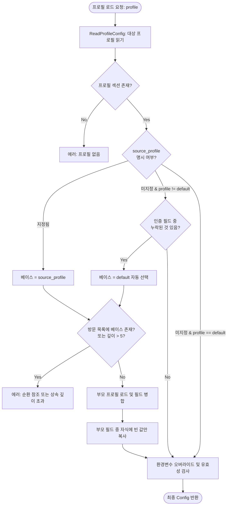

# 📋 [JC-9] AWS CLI 스타일 프로필 상속(source_profile 및 Default Fallback) 개발 계획

- **티켓 키**: [JC-9](https://joincdream.atlassian.net/browse/JC-9)
- **티켓 요약**: `[Feature] AWS CLI 스타일 프로필 상속(source_profile 및 Default Fallback) 지원`
- **담당자**: AI 에이전트 & 윤상배
- **상태**: 완료 (Done)
- **라벨**: `Architecture`, `Development`

---

## 💡 사용자 관점의 핵심 개선 효과 (What Changes for Users?)

| 구분 | ❌ 현재의 불편함 (Before) | ✨ 개선 후 사용자 경험 (After) |
| :--- | :--- | :--- |
| **스페이스별 프로필 분리** | 동일 테넌트에서 프로젝트가 5개면, 5개 프로필에 `instance_url`, `email`, `api_token`을 **각각 복사/붙여넣기**해야 함 | 베이스(`default`)에 토큰을 1번만 두고, 서브 프로필에는 **`project_key = JC` 단 1줄만 적으면 끝** |
| **API 토큰 갱신 (Rotation)** | API 토큰이 만료/갱신되면 config 파일 내 모든 프로필을 찾아다니며 **수동으로 하나하나 토큰을 교체**해야 함 | 베이스 프로필(`default` 또는 부모 테넌트)의 **토큰 1곳만 바꾸면 모든 서브 프로젝트 프로필에 즉시 동기화** |
| **타 테넌트 프로필 상속** | 부모 프로필이 `default`가 아닌 다른 테넌트(예: `[company-b]`)인 경우 설정을 재사용할 방법이 없음 | **`source_profile = company-b`** 옵션을 통해 원하는 부모 테넌트의 인증 키를 명시적으로 상속 가능 |
| **순환 참조 오작동 방지** | 상속 설정 시 `A -> B -> A` 형태의 무한 루프가 발생하면 CLI가 응답 없이 멈출 위험 존재 | 순환 상속 체인을 즉시 감지하여 **"순환 참조 발생(A -> B -> A)" 에러를 발생시키고 안전하게 차단** |

---

## 1. 개요 및 배경 (Background & Objectives)

### 1.1 현재 문제점
1. **자격 증명 중복 저장 (DRY 원칙 위배)**:
   - 현재 `pkg/client.go`의 `LoadConfigFileForProfile`은 모든 프로필 섹션이 `instance_url`, `email`, `api_token`을 온전히 갖출 것을 요구함.
   - 단일 Atlassian 테넌트 내에서 여러 프로젝트/스페이스(예: FE, BE, DEVOPS)를 다루거나 디렉토리별 `.jira-profile` 연동을 위해 프로필을 분리할 때마다 동일한 API 토큰을 중복 기술해야 함.
2. **토큰 보안 관리 및 갱신 비용 증가**:
   - 동일한 비밀 토큰이 파일 내 여러 군데 복제되어 노출 표면이 넓어지고, 토큰 로테이션 시 수정 누락으로 인한 401 Unauthorized 장애 위험 상존.
3. **AWS CLI 프로필 모델과의 괴리**:
   - Jira CLI는 AWS CLI 스타일의 프로필 구조를 표방하고 있으나, AWS CLI의 핵심 기능인 자격 증명 재사용(`source_profile`)이 지원되지 않아 사용자 혼선 유발.

### 1.2 개발 목표
1. **암시적 상속 (`[default]` 자동 Fallback)**:
   - 프로필 섹션에 `instance_url`, `email`, `api_token` 중 일부 또는 전체가 누락된 경우, 자동으로 `[default]` 프로필의 해당 값을 상속.
2. **명시적 상속 (`source_profile = <name>`) 지원**:
   - `[default]` 외에 다른 테넌트 프로필을 부모로 두고자 할 때 `source_profile` 키를 지원하여 부모 프로필의 인증 정보를 상속.
3. **부분 오버라이드 (Selective Override)**:
   - 부모 프로필의 설정을 물려받으면서 특정 필드(예: `language`, `project_key`, 또는 별도 `email`)만 자식 프로필에서 재정의 가능.
4. **순환 참조 방지 (Circular Dependency Guardrail)**:
   - 상속 깊이 제한(최대 5단계) 및 방문 프로필 추적(`visited` set)을 통해 무한 루프 원천 차단.
5. **Zero-Dependency 원칙 준수**:
   - 외부 라이브러리 없이 Go 표준 라이브러리(`strings`, `bufio`, `fmt` 등)만으로 구현.

---

## 2. 영향 범위 분석 (Impact Analysis)

| 파일/모듈 | 변경 내용 및 역할 |
| :--- | :--- |
| `pkg/client.go` | • `Config` 구조체에 `SourceProfile` 필드 추가<br>• `ReadProfileConfig`에서 `source_profile` 파싱 지원<br>• `LoadConfigFileForProfile`에 프로필 상속 및 순환 참조 감지 체인 구현 |
| `pkg/client_test.go` | • `[default]` 자동 Fallback 테스트<br>• `source_profile` 명시적 상속 및 다단계 상속 테스트<br>• 순환 참조(`A -> B -> A`) 에러 감지 테스트<br>• 부모 필드 부분 오버라이드 검증 |
| `internal/app/commands_config.go` | • `jira configure` 대화형 마법사에서 프로필 추가 시 기존 프로필 상속 옵션 제공<br>• `jira configure --list` 프로필 출력 시 상속 관계(`(inherits: default)`) 표시 보강 |
| `internal/i18n/locales/{en,ko}.json` | • 상속 관련 에러 메시지(순환 참조, 부모 프로필 부재 등) 및 안내 문구 100% 다국어 카탈로그 등록 |
| `knowledge/configuration.md` | • 프로필 해석 4단계 다이어그램에 상속(Inheritance) 계층 반영 및 INI 스키마 업데이트 |
| `docs/02_CONFIGURATION.md` | • 사용자 가이드에 `source_profile` 및 상속 예제 추가 |

---

## 3. 상세 설계 (Detailed Design)

### 3.1 프로필 해석 및 상속 체인 알고리즘



### 3.2 상속 병합 규칙 (Field Merge Precedence)

각 필드(`instance_url`, `email`, `api_token`, `project_key`, `language`)의 최종 결정 우선순위:
1. **최우선**: OS 환경 변수 (`JIRA_INSTANCE_URL`, `JIRA_API_TOKEN` 등)
2. **2순위**: 자식 프로필에 명시적으로 선언된 값
3. **3순위**: 부모 프로필(`source_profile` 또는 `default`)의 값
4. **최종 기본값**: `project_key` 누락 시 `"KAN"` 폴백

### 3.3 설정 파일 예시 (`~/.config/jira/config`)

```ini
# 공통 테넌트 1: 메인 회사 인스턴스 (인증 키 1회만 기재)
[default]
instance_url = https://mycompany.atlassian.net
email = user@mycompany.com
api_token = ATATT3xFfGF0...
project_key = MAIN
language = ko

# 서브 프로젝트 1: [default] 자동 상속 (인증 키 생략)
[frontend]
project_key = FE

# 서브 프로젝트 2: [default] 자동 상속 + 언어 오버라이드
[backend]
project_key = BE
language = en

# 공통 테넌트 2: 외주/별도 고객사 인스턴스
[client-corp]
instance_url = https://clientcorp.atlassian.net
email = extern@clientcorp.com
api_token = ATATT9xZzKL1...
project_key = PROJ

# 외주 테넌트 기반 서브 프로젝트: 명시적 source_profile 지정
[client-mobile]
source_profile = client-corp
project_key = MOB
```

### 3.4 순환 참조 및 결함 방지 가드레일 (Safety Guardrails)
1. **Self-Reference 방지**: `source_profile`이 자기 자신을 가리키는 경우 즉시 에러.
2. **Circular Chain 방지**: `A -> B -> A` 또는 `A -> B -> C -> A` 순환 추적.
   - `visited := make(map[string]bool)`으로 추적하며 중복 진입 시 에러:
     `"프로필 상속 순환 참조가 감지되었습니다: frontend -> default -> frontend"`
3. **최대 상속 깊이(Max Depth) 제한**: 최대 5단계로 제한하여 비정상 설정 방지.
4. **미존재 부모 프로필 에러**: `source_profile = non-exist` 지정 시 친절한 안내 에러 출력.

---

## 4. 단계별 구현 계획 (Implementation Steps)

### Phase 1. 코어 설정 로더 리팩토링 (`pkg/client.go`)
- [x] `pkg.Config` 구조체에 `SourceProfile string` 필드 추가.
- [x] `ReadProfileConfig`에서 `source_profile` 키 파싱 로직 추가.
- [x] `resolveProfileInheritance(configPath, profile string, visited []string) (Config, error)` 재귀 헬퍼 함수 구현:
  - 방문 목록 기반 순환 감지.
  - 상속 깊이 체크.
  - 필드 단위 Fallback(부모 값 -> 자식 빈 필드 주입).
- [x] `LoadConfigFileForProfile`에 상속 리졸버 연동.

### Phase 2. 단위 테스트 구축 및 검증 (`pkg/client_test.go`)
- [x] `TestProfileInheritance_DefaultFallback`: `[default]` 프로필로부터 토큰/URL 자동 상속 검증.
- [x] `TestProfileInheritance_ExplicitSourceProfile`: `source_profile` 지정 상속 검증.
- [x] `TestProfileInheritance_FieldOverride`: 자식 프로필에서 특정 필드 오버라이드 동작 검증.
- [x] `TestProfileInheritance_CircularError`: 상속 순환 루프 시 정확한 에러 반환 검증.
- [x] `TestProfileInheritance_MissingBase`: 존재하지 않는 부모 프로필 참조 시 에러 검증.
- [x] 전체 패키지 단위 테스트(`go test -v ./...`) 100% 통과 확인.

### Phase 3. CLI 명령어 및 대화형 설정 개선 (`internal/app/`)
- [x] `jira configure` 실행 시:
  - 신규 프로필 생성 프롬프트에서 `기존 프로필의 인증 정보를 상속받으시겠습니까? [Y/n]` 선택지 제공.
  - 상속 선택 시 `source_profile` 입력받고 `project_key`만 빠르게 설정 완료.
- [x] `jira configure --list` 프로필 목록 테이블에 상속 여부(`Inherits`) 컬럼 표시.

### Phase 4. i18n 다국어 지원 (`internal/i18n/locales/`)
- [x] `en.json`, `ko.json`에 신규 에러 및 안내 메시지 추가:
  - `cmd.configure.prompt_inherit`
  - `cmd.configure.prompt_source_profile`
  - `cmd.configure.skip_credentials_notice`

### Phase 5. 지식 베이스(OKF) 및 공식 문서 갱신
- [x] `knowledge/configuration.md` 갱신 (상속 알고리즘 및 예시 추가).
- [x] `docs/02_CONFIGURATION.md` 갱신.
- [x] `knowledge/log.md`에 JC-9 작업 내역 및 검증 결과 기록.
- [x] `jira move JC-9`로 Jira 상의 상태를 동기화.

---

## 5. 검증 및 완료 기준 (Acceptance Criteria)

1. **단위 테스트 Pass**: `go test -v ./...` 실행 시 모든 패키지가 에러 없이 100% 통과할 것.
2. **실용적인 패키지 활용 (No Wheel Reinvention)**:
   - 품질과 안정성이 검증된 훌륭한 오픈소스 라이브러리가 있다면 불필요한 자체 구현을 지양하고 적극 활용하여 코드 복잡도를 최소화할 것.
3. **실제 CLI 검증**:
   - `[default]`에 토큰을 넣고 `[test-child]`에 `project_key = TEST`만 적은 상태에서 `jira --profile test-child list` 정상 실행 확인.
   - `source_profile`을 이용한 타 프로필 상속 및 순환 참조 에러 메시지 한/영 정상 출력 확인.
