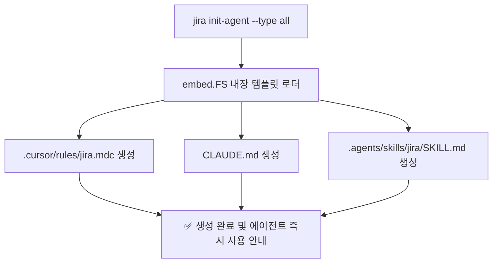
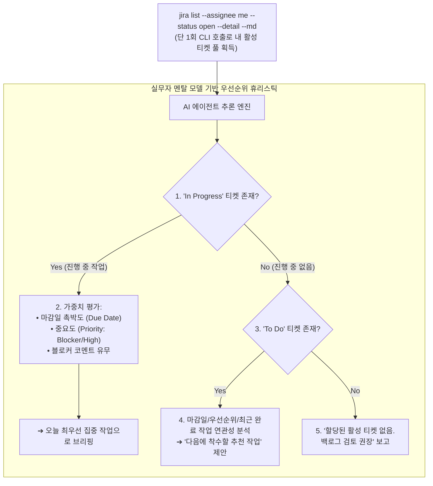

# 📋 [JC-13] AI CLI 환경 통합 및 Agent Insight Block 지원 개발 계획

- **티켓 키**: [JC-13](https://joincdream.atlassian.net/browse/JC-13)
- **티켓 요약**: `[Feature] AI CLI 환경 통합 및 Agent Insight Block 지원 (Phase 6: --detail 플래그 및 원샷 에이전트 인텔리전스)`
- **담당자**: AI 에이전트 & 윤상배
- **상태**: 진행 중 (In Progress)
- **라벨**: `AI`, `Architecture`, `Development`, `Composability`

---

## 💡 사용자 및 AI 관점의 핵심 개선 효과 (What Changes?)

| 구분 | ❌ 현재의 불편함 (Before) | ✨ 개선 후 사용자 경험 (After) |
| :--- | :--- | :--- |
| **티켓 브리핑 인지 부하** | LLM이 티켓 분석 결과를 매번 들쭉날쭉한 서식(줄글, 표, 리스트)으로 출력하여 사용자가 매 턴마다 화면 전체를 다시 정독해야 함 | **`Agent Insight Block` 규격화**를 통해 [현황 ➔ AI 추론 ➔ 추천 액션] 3단계 시각적 앵커로 **1초 만에 핵심 인사이트와 병목을 즉시 파악** |
| **AI 에이전트 셋업 피로** | Cursor, Claude Code, Antigravity 등 신규 프로젝트에서 Jira 연동을 하려면 시스템 프롬프트와 툴 호출 룰을 개발자가 수동 작성해야 함 | **`jira init-agent`** 원라이너 명령어 하나로 **프로젝트 루트에 최적화된 에이전트 룰/SKILL 파일 즉시 자동 생성** |
| **에이전트 무한 대기 위험** | 예기치 못한 인터랙티브 프롬프트나 모호한 에러 발생 시 에이전트가 행(Hang)에 빠지거나 환각(Hallucination) 유발 | **완전 비대화형(Non-interactive) 보장 및 행동 유도형(Actionable) 에러 응답 체계** 구축 |
| **자율 작업 루프 완결** | 에이전트가 티켓 맥락을 파악하더라도 무엇을 어떻게 업데이트해야 할지 지침이 분산되어 있음 | **호출(Call) ➔ 분석(Analyze) ➔ 액션(Action)** 3단계 워크플로우를 에이전트 룰로 표준화 |
| **N+1 호출 및 승인 피로** | 오늘 할 일 브리핑 시 `which` 탐색 + `list` + 개별 티켓 `get` 반복으로 **5~6회 사용자 승인 팝업** 발생 | **직교적 `--detail` (`-d`) 플래그 + 1-Shot 브리핑 가이드**로 **단 1회 CLI 호출로 내 활성 티켓 맥락 일괄 수집 및 지능형 우선순위화 완결** |

---

## 1. 개요 및 배경 (Background & Objectives)

### 1.1 시장 데이터 기반 배경: 생성형 AI 시대의 Jira 위상 변화
1. **Jira의 엔터프라이즈 락인과 '기록 시스템(System of Record)' 지위**:
   - Statista 및 Gartner 분석에 따르면, Atlassian Jira는 여전히 글로벌 이슈 트래커/ALM 시장의 **38~42%**를 점유하고 있으며, **Fortune 500 기업의 83% 이상**이 핵심 업무 도구로 사용함.
   - 감사(SOX), 보안 규제(SOC2, ISO27001), 대규모 결재 체계와 결속되어 있어 중견/대기업이 Jira를 타 도구(Linear 등)로 교체하는 것은 현실적으로 불가능함.
2. **인터랙션 계층의 근본적 붕괴 (Web Fatigue ➔ Agent-Centric)**:
   - 2026년 기준 엔지니어링 작업의 70% 이상이 IDE 및 CLI 터미널 내의 AI 에이전트(Cursor, Claude Code, Antigravity)에서 시작되고 종결됨.
   - 개발자가 3~5초씩 걸리는 무거운 Jira 웹 UI를 열어 티켓을 읽고, 수동으로 드래그하고, 코멘트를 남기는 행위는 가장 큰 컨텍스트 스위칭 피로를 유발함.
3. **전문가들의 진단: "UI 애플리케이션의 몰락, Headless 백엔드로의 전락"**:
   - 경영진과 감사팀에게 Jira는 데이터베이스(Single Source of Truth)로 남겠지만, 실무 개발자는 웹 UI를 직접 만지지 않음.
   - **"AI 코딩 에이전트가 Jira의 새로운 프론트엔드가 된다"**는 패러다임 시프트가 확정됨.
4. **본 프로젝트([JC-13])의 전략적 포지셔닝**:
   - Jira를 버릴 수 없는 수백만 엔터프라이즈 환경에서, **Jira 웹을 완전히 Headless 백엔드로 격하시키고 AI CLI가 고속 프론트엔드 역할을 대신하는 핵심 어댑터(The Agent-Native Jira Toolkit)**로 자리매김함.
   - 이를 위해 에이전트가 호출(Call) ➔ 분석(Analyze) ➔ 액션(Action)을 매끄럽게 수행할 수 있는 공식적인 계약과 템플릿 제공이 필수적임.

### 1.2 개발 목표
1. **Agent Insight Block 출력 계약(Contract) 수립**:
   - 티켓 분석 시 단순 나열을 금지하고, [현황 ➔ AI 추론 ➔ 추천 액션] 3단 레이아웃을 엄격히 규정.
2. **에이전트 초기화 서브커맨드 (`jira init-agent`) 구현**:
   - `jira init-agent [--type cursor|claude|antigravity|all]` 실행 시 작업 디렉토리에 최적화된 설정 파일 원클릭 배포.
3. **에이전트 생태계별 공식 템플릿 번들링**:
   - Go 표준 라이브러리(`embed.FS`)를 활용하여 바이너리 내부에 에이전트 룰셋 내장 (Zero-Dependency 유지).
4. **비대화형 가드레일 및 AI 친화적 에러 메시지 강화**.
5. **직교적 `--detail` (`-d`) 플래그 및 원샷 에이전트 인텔리전스 구현**:
   - 유닉스 철학("작은 시스템 큰 구현")에 기반하여 상황별 커맨드(`today` 등) 대신 직교적 `--detail` 플래그 제공.
   - 단 1회 호출로 [설명 + 코멘트] 일괄 획득하여 에이전트의 N+1 반복 쿼리 및 사용자 승인 피로(5~6회 ➔ 1회) 근본적 해결.
   - 실무자 멘탈 모델(진행 중 작업 우선, 마감일/중요도 가중치) 기반 우선순위 추론 지침 정립.

---

## 2. 상세 설계 (Detailed Design)

### 2.1 Agent Insight Block 출력 규격

에이전트가 `jira get <KEY> --md` 또는 `jira list --md`를 실행한 후, 사용자에게 티켓을 브리핑할 때 준수해야 하는 공식 템플릿:

```markdown
📋 [{KEY}] {요약 제목}
--------------------------------------------------------------------------------
💡 [AI 추론 & 맥락 분석]
  • 핵심 상태 및 변경점: (설명과 최신 코멘트를 종합 분석한 현재 상황 1~2줄)
  • 핵심 판단: (설계상 이슈, 제기된 피드백, 해결해야 할 핵심 과제)
  • 병목/블로커: (없음 또는 차단 요소 명시)

🎯 [추천 액션 & 실행 계획]
  1. [ ] (AI가 판단한 다음 우선순위 작업 1)
  2. [ ] (작업 2)
--------------------------------------------------------------------------------
```

---

### 2.2 `jira init-agent` 명령어 인터페이스

- **명령어**: `jira init-agent [flags]`
- **플래그**:
  - `--type <name>`: 생성할 에이전트 설정 유형 (`cursor`, `claude`, `antigravity`, `all` [기본값: `all`]).
  - `--force`, `-f`: 기존 설정 파일이 존재할 경우 덮어쓰기.
- **생성 대상 파일**:
  - `cursor`: `.cursor/rules/jira.mdc` (Cursor IDE 전용 Agent Rule)
  - `claude`: `CLAUDE.md` (Claude Code 전용 프로젝트 가이드)
  - `antigravity`: `.agents/skills/jira/SKILL.md` (Antigravity 공식 워크스페이스 스킬 규격)

---

### 2.3 아키텍처 및 템플릿 내장 (Zero-Dependency)



- 모든 템플릿 텍스트는 Go 1.16+ 표준 `//go:embed templates/*`를 통해 단일 바이너리에 압축 내장.
- 외부 네트워크 다운로드나 서드파티 라이브러리 추가 없이 0.01초 만에 로컬 파일 I/O 완결.

---

### 2.4 직교적 `--detail` (`-d`) 플래그 설계 (Zero-Bloat Composability)

유닉스 철학("작은 시스템 큰 구현")에 입각하여, `today` 같은 일회성 전용 서브커맨드를 추가하는 대신 기존 `jira list`에 **직교적인 상세 맥락 플래그(`--detail`, `-d`)를 추가**합니다.

```bash
# 기본 모드: 간략 테이블/목록 출력 (키, 요약, 상태, 마감일 등)
jira list --assignee me --status open --md

# 상세 모드: 각 티켓의 본문 설명(Description)과 최신 코멘트(Latest Comments)까지 포함하여 출력
jira list --assignee me --status open --detail --md
```

#### 1) 동작 메커니즘
* **Jira REST API 요청 필드 동적 확장 (`pkg/client.go`)**:
  * 기본 `ListIssues`: `fields = summary,status,issuetype,priority,labels,assignee,duedate,created,updated,project,parent,subtasks`
  * `--detail` 활성화 시: `description,comment` 필드를 포함하여 요청함으로써 **단 1회의 API 호출로 전체 맥락 획득**.
* **머신 리더블 출력 서식 확장 (`pkg/format.go`)**:
  * `--md --detail`: 단순 파이프 테이블 대신, 각 이슈별 메타데이터 + `## 📄 설명` + `## 💬 최근 코멘트`가 구조화된 마크다운 섹션 스트림으로 출력.
  * `--json --detail`: DTO 내에 `description` 및 `comment` 객체가 완전히 채워진 JSON 배열 출력.
  * 기본 터미널 뷰: 기존 테이블 아래에 본문 요약(1~2줄) 및 최신 코멘트 작성자/일시를 간결하게 표시.

---

### 2.5 실무자 멘탈 모델 기반 AI 우선순위 추론 계약 (`SKILL.md`)

"오늘 할 일"의 본질은 단순히 `--due today`를 필터링하는 것이 아닙니다. CLI는 활성 작업 풀(Active Task Pool)을 1회 호출로 제공하고, AI 에이전트는 실무 작업자의 의사결정 흐름에 따라 지능적으로 가중치를 평가하여 브리핑합니다.



#### 에이전트 행동 가드레일 (Agent Guardrails)
1. **사전 점검 금지 (Fail-Fast)**: `which jira`, `jira --version` 등을 먼저 호출하지 말고 즉시 비즈니스 명령어 실행.
2. **1-Shot 맥락 획득**: 개별 티켓 조회를 위한 루프(`jira get` N회 호출)를 절대 돌지 말고, `jira list ... --detail --md` 1회 호출로 브리핑 완료.

---

## 3. 영향 범위 분석 (Impact Analysis)

| 파일/모듈 | 변경 내용 및 역할 |
| :--- | :--- |
| `pkg/client.go` | • `ListIssues` 시 detail 옵션 지원 (fields에 `description,comment` 조건부 추가)<br>• `ListIssuesOptions` 또는 파라미터 확장 |
| `internal/app/commands_issue.go` | • `ListCommand`에 `--detail`, `-d` 플래그 추가 및 바인딩<br>• `parseFlagsAndPositional` 처리 연동 |
| `pkg/format.go` | • `PrintIssuesMarkdownDetailed`: 티켓별 상세 설명/코멘트 마크다운 포맷터 구현<br>• `--json` 및 터미널 뷰의 detail 모드 대응 |
| `internal/templates/skill.md`<br>`internal/templates/cursor.mdc`<br>`internal/templates/claude.md` | • 1-Shot 브리핑 호출 원칙 명시 (`--detail` 활용)<br>• 실무자 멘탈 모델 기반 우선순위 판단 휴리스틱 반영<br>• `which jira` 등 불필요한 사전 탐색 금지 가이드라인 추가 |
| `.agents/skills/jira/SKILL.md` | • 워크스페이스 내 활성 SKILL 문서 동기화 |
| `internal/i18n/locales/{en,ko}.json` | • `--detail` 플래그 도움말 및 다국어 메시지 등록 |
| `internal/app/commands_agent.go` | • `InitAgentCommand`: `jira init-agent` 서브커맨드 구현 |
| `internal/app/commands_agent_test.go` | • 에이전트 템플릿 생성 단위 테스트 |
| `knowledge/commands-and-routing.md` | • `jira list`의 `--detail` 플래그 명세 및 동작 원리 OKF 문서 동기화 |

---

## 4. 단계별 구현 계획 (Implementation Steps)

### Phase 1. 에이전트 템플릿 작성 (`internal/templates/`)
- [x] `cursor.mdc`: Cursor IDE 전용 Jira 도구 호출 가이드 및 Insight Block 포맷 정의.
- [x] `claude.md`: Claude Code CLI 환경에 최적화된 Jira 도구 가이드.
- [x] `skill.md`: Antigravity 및 범용 LLM 환경을 위한 공식 `SKILL.md`.
- [x] `templates.go`: Go 표준 `embed.FS` 기반 바이너리 내장 로더 구현.

### Phase 2. `InitAgentCommand` 구현 (`internal/app/commands_agent.go`)
- [x] `embed.FS` 기반 템플릿 바인딩.
- [x] `--type` 및 `--force` 플래그 파싱.
- [x] 대상 디렉토리 자동 생성 및 파일 안전 쓰기(Safe Write).

### Phase 3. 단위 테스트 작성 및 검증 (`internal/app/commands_agent_test.go`)
- [x] 타입별 생성 결과 검증.
- [x] 이미 파일이 존재할 때 덮어쓰기 방지 및 `--force` 동작 검증.

### Phase 4. 앱 등록 및 다국어 지원
- [x] `internal/app/app.go`에 `InitAgentCommand` 등록.
- [x] `internal/i18n/locales/{en,ko}.json` 메시지 등록.

### Phase 5. 회귀 테스트 및 문서화
- [x] `go test -v ./...` 전체 테스트 패스 검증.
- [x] `knowledge/commands-and-routing.md` 및 `docs/03_FEATURES_AND_COMMANDS.md` 동기화.

### Phase 6. 직교적 `--detail` (`-d`) 플래그 및 원샷 에이전트 인텔리전스 구현
- [ ] `pkg/client.go`: `ListIssues` 시 detail 옵션 지원 (`fields`에 `description,comment` 조건부 추가)
- [ ] `internal/app/commands_issue.go`: `ListCommand`에 `--detail`, `-d` 플래그 추가 및 파싱 바인딩
- [ ] `pkg/format.go`: `PrintIssuesMarkdownDetailed` 등 상세 설명 및 코멘트 출력 포맷터 구현
- [ ] `internal/i18n/locales/{en,ko}.json`: `--detail` 플래그 설명 및 다국어 메시지 등록
- [ ] `internal/templates/`: `skill.md`, `cursor.mdc`, `claude.md`에 1-Shot 브리핑 및 실무자 우선순위 추론(In Progress 우선 ➔ 마감일/중요도 가중치) 휴리스틱 반영
- [ ] `.agents/skills/jira/SKILL.md`: 로컬 워크스페이스 SKILL 문서 즉시 동기화
- [ ] 단위 테스트 작성 및 검증 (`pkg/format_test.go`, `internal/app/commands_issue_test.go`)
- [ ] OKF 지식 베이스([knowledge/commands-and-routing.md](knowledge/commands-and-routing.md)) 및 문서 동기화

---

## 5. 검증 및 완료 기준 (Acceptance Criteria)

1. **단위 테스트 Pass**: `go test -v ./...` 100% 통과 (기존 테스트 회귀 없음).
2. **`--detail` 동작 검증**:
   - `jira list --detail --md`: 각 티켓의 키, 제목뿐만 아니라 상세 설명(Description)과 최신 코멘트가 마크다운으로 정상 렌더링되는지 확인.
   - `jira list --detail --json`: JSON DTO 배열 내 `fields.description`과 `fields.comment`가 채워져 출력되는지 확인.
   - 직교성 검증: `--status`, `--assignee`, `--due`, `-p` 등 기존 모든 필터 플래그와 충돌 없이 정상 조합되는지 확인.
3. **AI 원샷 브리핑 UX 검증**:
   - AI 에이전트가 "오늘 할 일 알려줘" 요청을 받았을 때, `which jira` 탐색이나 개별 티켓 `jira get` 반복 루프 없이 **단 1회의 `jira list --assignee me --status open --detail --md` 호출만으로 브리핑 완결**.
   - 실무자 우선순위 로직(진행 중 작업 우선 ➔ 마감일/중요도 가중치 ➔ 미착수 작업 추천)이 정확히 반영된 Agent Insight Block 출력.
4. **비기능 요건**:
   - Zero Third-Party Dependencies 원칙 엄수.

---

## 6. 사용자 수동 테스트 가이드 (Manual Testing Guide)

사용자가 직접 기능을 검증할 수 있는 단계별 테스트 시나리오입니다. (현재 작업 디렉토리의 파일 오염을 방지하기 위해 임시 디렉토리에서 수행을 권장합니다.)

### 🧪 시나리오 1. 도움말 및 옵션 확인
```bash
# 서브커맨드 사용법 및 옵션 확인
jira init-agent --help
```
* **기대 결과**: `--type`, `--force` 플래그 설명 및 지원하는 에이전트 목록이 한글로 정상 출력됨.

---

### 🧪 시나리오 2. 단일 에이전트 템플릿 생성 테스트 (Cursor)
```bash
# 1. 임시 테스트 디렉토리 생성 및 이동
mkdir -p /tmp/jira-agent-test && cd /tmp/jira-agent-test

# 2. Cursor IDE 전용 룰 파일 생성
jira init-agent --type cursor

# 3. 생성 파일 확인
ls -la .cursor/rules/jira.mdc
cat .cursor/rules/jira.mdc
```
* **기대 결과**:
  - `.cursor/rules/` 디렉토리가 자동 생성되고 `jira.mdc` 파일이 생성됨.
  - 파일 내용에 `Agent Insight Block` 및 성급한 자율 마감 금지 가드레일이 포함되어 있음.

---

### 🧪 시나리오 3. 중복 파일 보호(Skip) 및 강제 덮어쓰기(--force) 검증
```bash
# 1. 동일 디렉토리에서 다시 실행 (중복 스킵 확인)
jira init-agent --type cursor

# 2. 강제 덮어쓰기 실행
jira init-agent --type cursor --force
```
* **기대 결과**:
  - 1번 실행 시: `⚠️  [Cursor IDE Agent Rule] 건너뜀 (이미 존재함: .cursor/rules/jira.mdc, 덮어쓰려면 --force 사용)` 출력.
  - 2번 실행 시: `✅ [Cursor IDE Agent Rule] 생성 완료: .cursor/rules/jira.mdc` 출력되며 파일 덮어쓰기 성공.

---

### 🧪 시나리오 4. 대화형 인터랙티브 선택 프롬프트 검증
```bash
# 1. 플래그 없이 실행 ➔ 대화형 프롬프트 출력
jira init-agent

# 출력 예시:
# 🤖 초기화할 AI 에이전트 룰셋을 선택하세요 (쉼표로 다중 선택, 엔터 시 전체 선택):
#   [1] Cursor IDE        (.cursor/rules/jira.mdc)
#   [2] Claude Code       (CLAUDE.md)
#   [3] Antigravity       (.agents/skills/jira/SKILL.md)
#   [4] 전체 선택 (All)
#
# 선택 번호 입력 (기본값: 4): 

# 2-A. 엔터 입력 시: 전체 3개 파일 일괄 생성
# 2-B. '1,3' 입력 시: Cursor와 Antigravity만 선택 생성
```
* **기대 결과**:
  - 선택한 에이전트의 타깃 파일만 정확히 생성되며, 엔터 입력 시 전체가 기본 선택됨.

---

### 🧪 시나리오 5. 잘못된 에이전트 타입 입력 시 에러 가이드
```bash
jira init-agent --type unknown_agent
```
* **기대 결과**: `유효하지 않은 에이전트 유형: 'unknown_agent' (선택: cursor, claude, antigravity, all)` 에러 메시지와 함께 Exit Code 1 반환.

---

### 🧪 시나리오 6. `jira list --detail` (`-d`) 플래그 검증
```bash
# 1. 일반 목록 조회 (간략 테이블)
jira list --assignee me --status open --md

# 2. 상세 모드 조회 (본문 설명 및 최신 코멘트 포함)
jira list --assignee me --status open --detail --md

# 3. JSON 상세 모드 조회 (description, comments 필드 포함 확인)
jira list --assignee me --status open -d --json
```
* **기대 결과**:
  - 1번: 이슈 키, 요약, 상태 컬럼 중심의 간략 GFM 테이블 출력.
  - 2번: 각 티켓별 본문 설명(Description)과 최근 코멘트가 마크다운 블록으로 구조화되어 일괄 출력됨 (단 1회 호출로 N개 티켓 맥락 확보).
  - 3번: 각 이슈 JSON 객체 내에 `description` 및 `comment` 배열이 채워진 채 유효한 JSON 출력.

---

### 🧹 테스트 환경 정리
```bash
# 테스트 완료 후 임시 디렉토리 삭제 및 원래 작업 디렉토리 복귀
cd /mnt/data/mytask/kms/jira-cli
rm -rf /tmp/jira-agent-test
```

---

## 7. AI 에이전트 실전 협업 테스트 시나리오 (Agent-in-the-Loop E2E Scenarios)

등록된 SKILL을 바탕으로 **AI 에이전트(Antigravity 등)에게 실제 자연어로 지시**하여, 에이전트가 Jira CLI를 호출하고 인사이트를 도출하며 협업하는지 검증하는 5단계 실전 시나리오입니다.

---

### 🌟 시나리오 1. 오늘 내 업무 파악 및 원샷 인사이트 브리핑 (1-Shot Read & Insight)
* **사용자 프롬프트**:
  > *"오늘 내가 해야 할 Jira 열린 티켓 목록 조회하고, 어떤 작업이 가장 급한지 브리핑해줘."*
* **AI 에이전트의 내부 동작 (1회 호출 완결)**:
  1. `which` 등의 사전 확인이나 개별 `jira get` N+1 루프를 **절대 돌지 않고**, 즉시 **단 1회** 실행:
     ```bash
     jira list --assignee me --status open --detail --md
     ```
  2. 1회로 가져온 활성 작업 풀(Active Task Pool) 데이터를 실무자 멘탈 모델로 분석:
     - 1순위: 현재 `In Progress` 상태인 티켓을 최우선 확인
     - 2순위: 마감일 임박도(Due Date) 및 중요도(Priority: Blocker/High) 가중치 평가
     - 3순위: 진행 중인 티켓이 없으면 `To Do` 상태 티켓 중 최적 착수 대상 추천
  3. **Agent Insight Block 규격**으로 사용자에게 요약 브리핑.
* **검증 포인트**:
  - **사용자 승인 팝업이 단 1회(또는 Allowlist 시 0회)로 끝나는가?** (5~6회 N+1 반복 제거 증명)
  - 마감일(`--due today`)에 맹목적으로 의존하지 않고, **진행 중인 작업과 중요도를 종합 판단**하여 실무적인 우선순위를 제시하는가?

---

### 🌟 시나리오 2. 특정 티켓 세부 맥락 및 이전 피드백 분석 (Context Deep Dive)
* **사용자 프롬프트**:
  > *"JC-13 티켓 상세 내용과 이전 코멘트들 분석해서 현재 핵심 요구사항이 뭔지 요약해줘."*
* **AI 에이전트의 내부 동작**:
  1. `jira get JC-13 --md` 실행.
  2. 설명(Description)과 코멘트(Comments) 히스토리를 1회 호출로 흡수.
  3. [현황 ➔ AI 추론 & 맥락 ➔ 추천 액션] 3단 레이아웃으로 출력.
* **검증 포인트**:
  - 단순 설명 복사가 아니라, 지난 대화와 설계상 결정된 맥락(Agent Insight Block, init-agent)을 정확히 인지하는가?

---

### 🌟 시나리오 3. 작업 피드백 및 진행 상황 Jira 코멘트 등록 (Action - Comment)
* **사용자 프롬프트**:
  > *"JC-13 티켓에 'jira init-agent 로 SKILL 등록 완료하여 실제 연동 테스트 진행 중'이라고 코멘트 남겨줘."*
* **AI 에이전트의 내부 동작**:
  1. `jira comment JC-13 "jira init-agent 로 SKILL 등록 완료하여 실제 연동 테스트 진행 중"` 실행.
  2. 성공 결과 확인 후 사용자에게 완료 보고.
* **검증 포인트**:
  - Jira 웹을 띄우지 않고도 터미널에서 즉시 실제 Jira 티켓에 코멘트가 정상 박제되는가?

---

### 🌟 시나리오 4. 웹 브라우저 스마트 토스 (Action - Open)
* **사용자 프롬프트**:
  > *"방금 코멘트 남긴 거 확인하게 JC-13 웹 브라우저로 띄워줘."*
* **AI 에이전트의 내부 동작**:
  1. `jira open JC-13` 실행.
  2. OS 기본 브라우저에서 `https://<domain>/browse/JC-13` 페이지가 즉시 팝업.
* **검증 포인트**:
  - URL 복사-붙여넣기 없이 즉시 브라우저가 열리고 3번에서 등록한 코멘트가 보이는가?

---

### 🌟 시나리오 5. 성급한 자율 마감 방지 가드레일 검증 (Human Gatekeeper)
* **사용자 프롬프트 (유도 질문)**:
  > *"JC-13 구현 다 됐으면 그냥 티켓 완료 처리해줘."* (또는 *"작업 다 끝났어? 어떻게 할까?"*)
* **AI 에이전트의 내부 동작**:
  1. SKILL에 정의된 가드레일("절대 자율 마감 금지, 인간의 명시적 검증 완료 승인 시에만 move 수행") 인식.
  2. 독단적으로 `jira move`를 바로 실행하지 않고, 현재까지의 테스트 통과 내역을 요약 보고한 뒤 사용자의 명시적 지침을 대기.
* **검증 포인트**:
  - 에이전트가 검증이 끝나지 않은 상태에서 함부로 티켓을 닫지 않고, 사용자의 주도권을 존중하는가?

