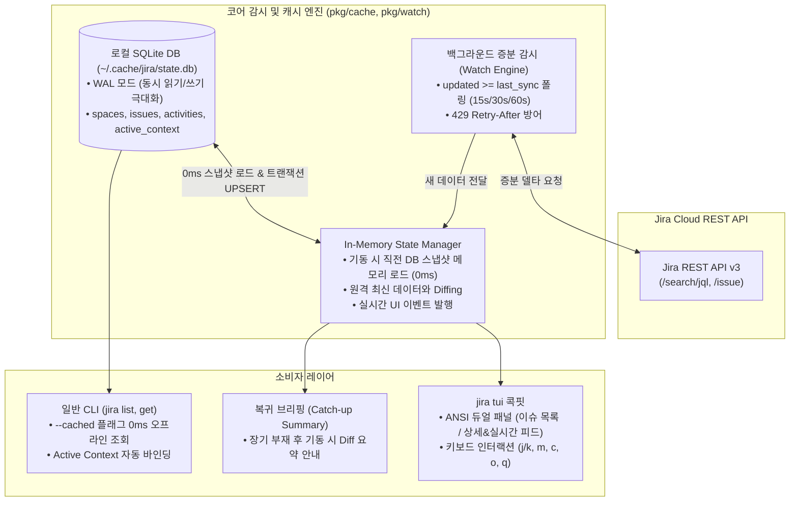
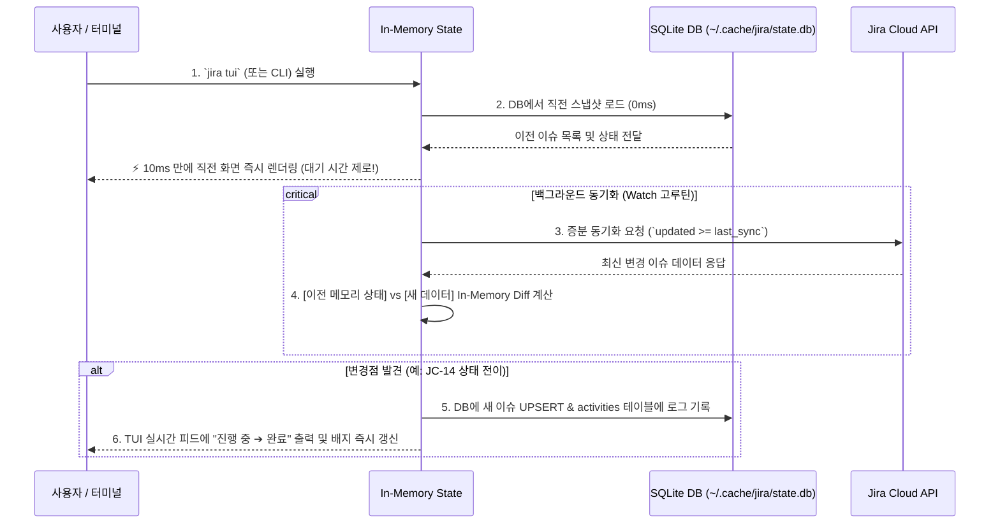

# 📋 [JC-17] jira tui 실시간 대시보드 및 SQLite 공유 캐시 감시(Watch) 엔진 구현 개발 계획

- **티켓 키**: [JC-17](https://joincdream.atlassian.net/browse/JC-17)
- **티켓 요약**: `[Feature] jira tui 실시간 대시보드 및 공유 캐시 감시(Watch) 엔진 구현`
- **담당자**: 윤상배 & AI 에이전트
- **상태**: 진행 중 (In Progress)
- **라벨**: `AI`, `Architecture`, `Development`

---

## 💡 사용자 및 AI 관점의 핵심 개선 효과 (What Changes?)

| 구분 | ❌ 현재의 불편함 (Before) | ✨ 개선 후 사용자 경험 (After) |
| :--- | :--- | :--- |
| **실시간 변경 가시성** | AI 에이전트가 상태를 전이하거나 코멘트를 남길 때 웹 브라우저를 계속 새로고침해야 함 | 서브 터미널에 **`jira tui`**를 띄워두면 에이전트의 작업 결과가 실시간(Activity Feed)으로 자동 갱신 |
| **API 호출 지연 및 비용** | `jira list`, `jira get` 실행 시 매번 Jira Cloud REST API 왕복(500ms~1.5s) 발생 | **로컬 SQLite 캐시(`~/.cache/jira/state.db`)** 연동으로 **0ms(Zero-API)** 즉시 응답 |
| **기동 지연 제로 (0ms)** | 프로그램 기동 시 원격 API 응답을 기다려야 화면이 뜸 | **Stale-While-Revalidate (SWR)** 패턴으로 직전 캐시를 10ms 만에 메모리 로드 후 즉시 화면 렌더링 |
| **다중 스페이스 / Obsidian 연동** | 여러 Jira 스페이스(프로젝트) 작업 시 캐시 분리 및 충돌 우려 | **단일 SQLite DB 내 스페이스별 통합 관리 & 인덱싱**으로 크로스 프로젝트 집계 및 전환 원활 |
| **휴가/장기 부재 복귀 가시성** | 오랜만에 접속 시 무엇이 바뀌었는지 파악 불가 | **In-Memory Diffing**으로 부재 중 발생한 상태 전이(`진행 중 ➔ 완료`) 및 코멘트 요약 브리핑 자동 출력 |
| **1인 개발 컨텍스트 유지** | `main` 브랜치 작업 시 티켓 키를 기억하거나 매번 수동 입력해야 함 | 캐시 내 **Active Ticket Context (`jira use <KEY>`)**로 브랜치 분리 없이도 무인자 CLI 작업 완결 |

---

## 1. 개요 및 배경 (Background & Objectives)

### 1.1 배경: 실용적 의존성 관리와 SQLite 기반 로컬 캐시의 필요성
1. **실용적 의존성 관리 (Pragmatic Dependencies)**:
   - 과도한 서드파티 의존성은 배제하되, 바퀴를 재발명하지 않기 위해 트랜잭션, 파일 락, 부분 수정(Partial Update)이 검증된 **Pure Go SQLite (`modernc.org/sqlite`)**를 채택함.
   - `CGO_ENABLED=0` 환경에서도 완벽히 컴파일되어 Linux, macOS(Apple Silicon 포함), Windows 어디서나 단일 정적 바이너리 배포 및 크로스 컴파일 가능.
2. **AI 에이전트 협업 시의 블랙박스 해소**:
   - Claude Code, Antigravity, Cursor 등 자율 코딩 에이전트의 작업 결과(상태 전이, 코멘트)를 브라우저 새로고침 없이 서브 터미널에서 즉시 관측.
3. **Obsidian 다중 프로젝트 스페이스 관리**:
   - 여러 Jira 스페이스의 데이터를 하나의 SQLite DB(`~/.cache/jira/state.db`)에서 스키마와 인덱스를 통해 안전하게 통합 관리.

---

## 2. 상세 아키텍처 및 설계 (Detailed Architecture)



---

### 2.1 로컬 공유 캐시 엔진 (`pkg/cache.go` - Pure Go SQLite)

- **스토리지 드라이버**: `modernc.org/sqlite` (Pure Go, CGO 제로, 크로스 컴파일 완벽 보장)
- **저장 위치**: `~/.cache/jira/state.db` (WAL 모드: `PRAGMA journal_mode=WAL;` / `PRAGMA synchronous=NORMAL;`)
- **데이터베이스 스키마 명세**:
  ```sql
  -- 1. 다중 스페이스(프로젝트) 메타데이터
  CREATE TABLE IF NOT EXISTS spaces (
      key TEXT PRIMARY KEY,
      name TEXT,
      last_sync_at DATETIME
  );

  -- 2. 전체 스페이스 이슈 통합 테이블 (고속 필터링 및 인덱싱)
  CREATE TABLE IF NOT EXISTS issues (
      key TEXT PRIMARY KEY,
      space TEXT NOT NULL,
      summary TEXT NOT NULL,
      status TEXT NOT NULL,
      assignee TEXT,
      issue_type TEXT,
      due_date TEXT,
      raw_json TEXT NOT NULL,
      updated_at DATETIME NOT NULL
  );
  CREATE INDEX IF NOT EXISTS idx_issues_space ON issues(space);
  CREATE INDEX IF NOT EXISTS idx_issues_status ON issues(status);
  CREATE INDEX IF NOT EXISTS idx_issues_updated ON issues(updated_at DESC);

  -- 3. 실시간 변경 피드 (Activity Stream)
  CREATE TABLE IF NOT EXISTS activities (
      id INTEGER PRIMARY KEY AUTOINCREMENT,
      space TEXT NOT NULL,
      issue_key TEXT NOT NULL,
      author TEXT,
      event_type TEXT NOT NULL, -- STATUS_CHANGE, COMMENT_ADDED, CREATED, UPDATED
      details TEXT NOT NULL,
      created_at DATETIME NOT NULL
  );
  CREATE INDEX IF NOT EXISTS idx_activities_created ON activities(created_at DESC);

  -- 4. 전역 활성 컨텍스트 (active_project, active_issue_key 등)
  CREATE TABLE IF NOT EXISTS active_context (
      key TEXT PRIMARY KEY,
      value TEXT NOT NULL
  );
  ```

- **주요 Go API 인터페이스 (`pkg/cache.go`)**:
  ```go
  type CacheDB struct { db *sql.DB }

  func OpenCacheDB(path string) (*CacheDB, error)
  func (c *CacheDB) Close() error
  func (c *CacheDB) UpsertIssues(space string, issues []Issue) error
  func (c *CacheDB) GetIssues(space string, statusFilter string) ([]Issue, error)
  func (c *CacheDB) LogActivity(evt ActivityEvent) error
  func (c *CacheDB) GetRecentActivities(limit int, spaceFilter string) ([]ActivityEvent, error)
  func (c *CacheDB) SetActiveIssue(key string) error
  func (c *CacheDB) GetActiveIssue() (string, error)
  func (c *CacheDB) PruneDeletedIssues(space string, currentKeys []string) error
  ```

---

### 2.2 SWR 기동 & In-Memory Snapshot Diffing 파이프라인

프로그램 기동 시 지연 시간을 없애고 변경점을 정밀 감지하기 위해 **Stale-While-Revalidate (SWR)** 패턴을 적용합니다.



#### Diff 분석 규칙:
- `old.Status != new.Status` ➔ `STATUS_CHANGE` 이벤트 발행 (예: `"진행 중 ➔ 완료 (by 윤상배)"`)
- `len(new.Comments) > len(old.Comments)` ➔ `COMMENT_ADDED` 이벤트 발행
- `old == nil` (새로 발견된 키) ➔ `CREATED` 이벤트 발행

---

### 2.3 장기 부재(휴가 복귀 등) 시의 스마트 캐치업 (Catch-up) 동기화

마지막 동기화 시점으로부터 장기 공백(기본 **7일 이상**)이 발생한 경우:
1. **캐시 보존 및 Diff 기준점 활용**:
   - 로컬 SQLite 데이터를 무작정 삭제하지 않고, 부재 중 발생한 변화를 추적하는 비교 기준으로 보존합니다.
2. **복귀 브리핑 카드 (Welcome Back Digest)**:
   - TUI 진입 시 또는 CLI 기동 시 부재 중 일어난 변경 사항을 한눈에 요약 출력합니다:
     ```text
     ┌─ [Welcome Back! 부재 중 업무 변경 브리핑] ────────────────────────────┐
     │ 🏖️ 마지막 동기화(14일 전) 이후 총 8건의 변경사항이 감지되었습니다:          │
     │  ✨ 내게 새로 할당된 티켓: [JC-20] (결제 모듈 긴급 패치)                 │
     │  🔄 상태 변경된 내 티켓: [JC-14] 진행 중 ➔ 완료 (by 윤상배)               │
     │  💬 확인해야 할 신규 코멘트: 5건                                      │
     └─────────────────────────────────────────────────────────────────────┘
     ```
3. **고스트 데이터 정리 (Pruning)**:
   - 부재 중 삭제되거나 타 프로젝트로 이관된 티켓은 현재 원격 키 세트와 대조하여 로컬 DB에서 자동 정리합니다.
4. **수동 비상 리셋**:
   - 캐시 불일치 시 `jira cache clean` 또는 `jira sync --fresh`로 언제든 백지 상태 재구축 지원.

---

### 2.4 Bubble Tea + Lip Gloss 기반 모던 TUI 콕핏 (`internal/tui/`)

Go TUI 업계 표준인 **`github.com/charmbracelet/bubbletea`** (Elm Architecture MUV)와 **`github.com/charmbracelet/lipgloss`**를 채택하여, 깜빡임 없는 더블 버퍼링, 반응형 윈도우 리사이즈, 한글(UTF-8 2칸 너비) 줄맞춤을 완벽 지원합니다:
- **화면 레이아웃 시각화 미리보기**:
  > 👉 **[🖥️ TUI 콕핏 화면 시각화 Mockup 열기 (HTML)](file:///home/yundream/mytask/kms/jira-cli/task/JC-17-tui-preview.html)**

| 영역 | 구성 요소 | 주요 역할 |
| :--- | :--- | :--- |
| **상단 타이틀바** | 인스턴스/프로젝트 정보, 동기화 상태 배지 | 현재 연결 프로필 및 최근 백그라운드 동기화 경과 시간 표시 |
| **좌측 패널 (45%)** | 활성 이슈 목록 (Active Issues) | `j/k` 이동, 상태별 배지(진행 중/할 일), 선택 커서(`>`) |
| **우측 상단 패널 (55%)** | 티켓 상세 카드 (Detail Card) | 선택된 이슈의 키, 제목, 상태, 담당자, 설명 미리보기 |
| **우측 하단 패널 (55%)** | 실시간 변경 피드 (Live Activity Stream) | SWR Diffing 엔진이 수집한 타임스탬프별 최신 변경 이벤트 로그 |
| **하단 푸터바** | 단축키 가이드 및 단축 명령 | 단축키(`j/k`, `Enter`, `m`, `c`, `o`, `r`, `q`) 레퍼런스 상시 노출 |

---

### 2.5 CLI 서브커맨드 연동 (`internal/app/`)

1. **`jira tui [flags]`**:
   - TUI 대시보드 실행 (기본 포그라운드).
   - 플래그: `--interval <sec>` (기본 15초), `-p, --project <KEY>`.
2. **`jira watch [flags]`**:
   - TUI 없이 터미널에 변경 이벤트를 tail -f 형태로 실시간 스트리밍 출력.
3. **`jira list --cached` / `jira get --cached`**:
   - 네트워크 호출 없이 `~/.cache/jira/state.db`에서 0ms 즉시 조회.
4. **`jira use <KEY>`**:
   - 로컬 DB의 `active_context`에 활성 티켓을 설정하여, `main` 브랜치에서도 Zero-Argument 타깃으로 자동 바인딩.
5. **`jira cache clean` / `jira sync --fresh`**:
   - SQLite 캐시를 완전 초기화하고 원격 최신 데이터로 백지 재동기화.

---

## 3. 영향 범위 및 변경 파일 목록

| 파일 경로 | 변경 내용 및 역할 |
| :--- | :--- |
| `go.mod`, `go.sum` | `modernc.org/sqlite` 순수 Go 드라이버 의존성 등록 |
| `pkg/cache.go` (신규) | Pure Go SQLite 연결, WAL 설정, 스키마 마이그레이션, Issues/Activities/Context CRUD |
| `pkg/cache_test.go` (신규) | SQLite 인메모리(`:memory:`) 및 파일 기반 CRUD, 동시성, Prune 단위 테스트 |
| `pkg/watch.go` (신규) | 백그라운드 증분 폴링, In-Memory Diff 계산기, 적응형 백오프(15s/30s/60s), 429 방어 |
| `pkg/watch_test.go` (신규) | Diff 분석기 및 백오프 알고리즘 Mock 테스트 |
| `internal/tui/screen.go` (신규) | 터미널 Raw Mode 진입/복원, ANSI 렌더러, 윈도우 리사이즈 감지 |
| `internal/tui/app.go` (신규) | TUI 메인 이벤트 루프, 듀얼 패널 렌더링, 키보드 이벤트 핸들러 |
| `internal/app/commands_tui.go` (신규) | `jira tui`, `jira watch`, `jira use`, `jira cache` 서브커맨드 구현 |
| `internal/app/app.go` | 신규 명령어 라우터 등록 |
| `internal/app/commands_issue.go` | `jira list --cached`, `jira get --cached` 플래그 및 `pkg.ResolveIssueKey` 캐시 Fallback 연결 |
| `internal/i18n/locales/{en,ko}.json` | TUI, Cache, Watch 다국어 메시지 카탈로그 등록 |
| `knowledge/commands-and-routing.md` | `tui`, `watch`, `use`, `cache`, `--cached` 명세 추가 |

---

## 4. 단계별 구현 계획 (Implementation Steps)

### Phase 1. SQLite 로컬 공유 캐시 엔진 (`pkg/cache.go`)
- [x] `modernc.org/sqlite` 패키지 설치 (`go get modernc.org/sqlite`)
- [x] `pkg/cache.go` 작성:
  - SQLite 연결 풀 및 WAL 모드 활성화
  - 4개 테이블 스키마 DDL 마이그레이션
  - 이슈 일괄 Upsert 및 조회 API
  - 실시간 활동(Activity) 로그 기록 및 최근 N개 조회 API
  - 활성 티켓 컨텍스트(`active_context`) API
  - 고스트 티켓 정리(`PruneDeletedIssues`) API
- [x] `pkg/cache_test.go` 작성 및 100% 검증

### Phase 2. SWR 증분 감시 및 Diffing 엔진 (`pkg/watch.go`)
- [x] In-Memory State 매니저 및 직전 스냅샷 로드
- [x] `updated >= timestamp` 증분 JQL 쿼리 빌더
- [x] In-Memory Diff 계산기 (상태 전이, 코멘트 추가, 신규 생성 감지)
- [x] 적응형 백오프(15s ➔ 30s ➔ 60s) 및 429 Retry-After 방어
- [x] 장기 부재(7일 이상) 감지 및 복귀 브리핑 데이터 조립 로직
- [x] `pkg/watch_test.go` 작성 및 100% 검증

### Phase 3. Bubble Tea + Lip Gloss 터미널 콕핏 엔진 (`internal/tui/`)
- [x] Bubble Tea MUV 아키텍처 및 AltScreen 버퍼링
- [x] Lip Gloss 기반 반응형 듀얼 패널 뷰포트 (이슈 목록 / 상세 정보 & Live Activity Feed)
- [x] 키보드 입력 핸들러(`j/k`, `Enter`, `c`, `o`, `r`, `ESC`, `q`)
- [x] `internal/tui/tui_test.go` 작성 및 100% 검증

### Phase 4. CLI 서브커맨드 통합 및 무인자 연계
- [x] `jira tui` 서브커맨드 연결 (`internal/app/commands_tui.go`)
- [x] `jira watch` CLI 이벤트 스트리머 연결
- [x] `jira use <KEY>` 활성 티켓 바인딩 연결
- [x] `pkg.ResolveIssueKey`에 3순위 Fallback으로 캐시의 `active_key` 연계
- [x] `jira list --cached`, `jira get --cached`, `jira cache clean`, `jira cache status` 지원
- [x] `internal/app/commands_tui_test.go` 작성 및 100% 검증

### Phase 5. 검증 및 문서화
- [x] `CGO_ENABLED=0` 크로스 컴파일 검증 (`GOOS=darwin`, `GOOS=linux`)
- [x] 전체 테스트 패스 (`go test -v ./...` 100% Pass)
- [x] `make install` 배포 및 TUI 실동작 검증
- [x] 지식 베이스([commands-and-routing.md](knowledge/commands-and-routing.md), [log.md](knowledge/log.md)) 동기화
- [x] `.agents/skills/jira/SKILL.md` 및 `~/.config/jira/SKILL.md` 레퍼런스 업데이트

---

## 5. 검증 및 완료 기준 (Acceptance Criteria)

1. **CGO 제로 크로스 컴파일**: `CGO_ENABLED=0` 환경에서 에러 없이 정적 바이너리 빌드 완료.
2. **0ms 기동 및 SWR Diffing**: `jira tui` 실행 시 10ms 만에 이전 데이터 표시 후, 변경 사항 발견 시 실시간 피드에 `"진행 중 ➔ 완료"` 즉시 갱신.
3. **0ms 오프라인 캐시 응답**: `jira list --cached` 실행 시 네트워크 호출 없이 로컬 SQLite에서 즉시 결과 출력.
4. **장기 부재 브리핑**: 7일 이상 동기화 공백 후 기동 시 부재 중 발생한 변경점 요약 카드 노출.
5. **Active Context Fallback**: `main` 브랜치에서 `jira use JC-17` 설정 후 `jira get` 실행 시 `JC-17`이 정상 조회됨.
6. **터미널 원복성**: `q` 또는 `Ctrl+C`로 TUI 종료 시 터미널 화면과 커서가 정상 복원되어 깨짐 현상이 없어야 함.
