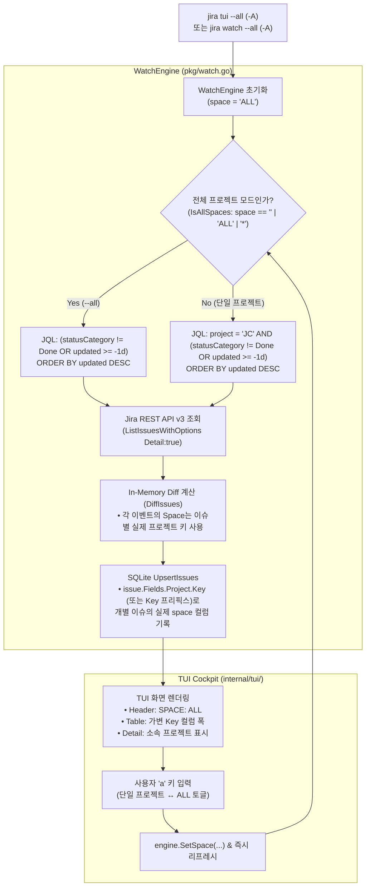

# 📋 [JC-19] jira tui 및 watch 전체 프로젝트 통합 관제(--all, -A) 개발 계획

- **티켓 키**: [JC-19](https://joincdream.atlassian.net/browse/JC-19)
- **티켓 요약**: `[Feature] jira tui 및 watch 전체 프로젝트 통합 관제(--all, -A) 지원`
- **담당자**: 윤상배 & AI 에이전트
- **상태**: 진행 중 (In Progress)
- **라벨**: `Architecture`, `Development`

---

## 💡 사용자 관점의 핵심 개선 효과 (What Changes for Users?)

| 구분 | ❌ 현재의 불편함 (Before) | ✨ 개선 후 사용자 경험 (After) |
| :--- | :--- | :--- |
| **다중 프로젝트 실시간 관제** | `jira tui` 및 `jira watch`가 단일 프로젝트(`-p <KEY>` 또는 기본 `project_key`)에만 묶여 있어, 여러 프로젝트를 운용할 때 터미널을 여러 개 띄워야 함 | **`jira tui --all` (`-A`)** 및 **`jira watch --all` (`-A`)** 명령 하나로 **테넌트 내 모든 프로젝트의 활성 티켓과 상태 변화를 단일 화면에서 통합 관제** |
| **TUI 실행 중 뷰 전환** | 특정 프로젝트만 보다가 전체 프로젝트를 보려면 TUI를 종료(`q`)하고 플래그를 바꿔 다시 실행해야 함 | TUI 실행 중 **`a` 단축키** 한 번으로 **단일 프로젝트 뷰 ↔ 전체 프로젝트(`ALL`) 뷰를 즉시 토글** |
| **로컬 SQLite 캐시 정합성** | 전체 조회 모드로 가져온 이슈들을 가상의 `"ALL"` 스페이스 이름으로 덮어쓰면 단일 프로젝트 조회(`-p JC`) 시 캐시가 분리/누락될 위험 존재 | 전체 모드(`--all`)로 폴링하더라도 **각 이슈의 실제 소속 프로젝트 키(`JC`, `KAN` 등)를 추출하여 DB에 저장**함으로써 단일/전체 모드 간 100% 캐시 호환성 유지 |
| **다중 프로젝트 식별 가시성** | 여러 프로젝트의 티켓이 섞여 있을 때 어떤 프로젝트 소속인지 상세 뷰에서 바로 알기 어려움 | 우측 상세 카드에 **소속 프로젝트 정보(`Project: [JC] ...`)를 표시**하고, 긴 프로젝트 키(`DEVOPS-123` 등)도 좌측 목록에서 잘리지 않도록 컬럼 패딩 최적화 |

---

## 1. 개요 및 배경 (Background & Objectives)

### 1.1 현재 문제점
1. **단일 프로젝트 고정 바인딩 (`internal/app/commands_tui.go`)**:
   - 현재 `jira list`와 `jira report`는 `--all` (`-A`) 플래그를 통해 테넌트 전체 프로젝트 조회를 지원하고 있으나, `jira tui`와 `jira watch`는 `-p`/`--project` 플래그만 지원하고 미지정 시 설정 파일의 단일 `ProjectKey`로 강제 고정됨.
2. **WatchEngine의 단일 프로젝트 JQL 하드코딩 (`pkg/watch.go`)**:
   - `WatchEngine.syncRemote`에서 항상 `project = '%s' AND ...` 형태의 JQL을 생성하므로 전체 프로젝트 폴링이 불가능함.
3. **캐시 DB 스페이스 저장 방식 (`pkg/cache.go`, `pkg/watch.go`)**:
   - `UpsertIssues(w.space, fetched)` 호출 시 `w.space` 문자열을 모든 이슈의 `space` 컬럼에 일괄 기록하고 있어, 멀티 프로젝트 이슈들이 한꺼번에 들어올 때 개별 이슈의 원래 프로젝트 키를 보존하는 처리가 필요함.

### 1.2 개발 목표
1. **CLI 플래그 일관성 확보**:
   - `jira tui`와 `jira watch` 모두 `--all` 및 단축 플래그 `-A`를 지원하여 `jira list --all`, `jira report --all`과 동일한 UX 제공.
2. **멀티 프로젝트 `WatchEngine` 및 캐시 호환성 구현**:
   - 전체 프로젝트 모드(`space == "ALL"` 또는 `""`, `"*"`)일 때 JQL에서 `project = ...` 조건을 생략하고 `(statusCategory != Done OR updated >= -1d) ORDER BY updated DESC`로 테넌트 전체 변경분 감지.
   - 각 이슈 저장 및 이벤트 발행 시 이슈의 실제 프로젝트 키(`issue.Fields.Project.Key` 또는 이슈 키의 `<PROJECT>-<NUM>` 프리픽스)를 자동 추출하여 기록.
3. **TUI 멀티 프로젝트 UX 및 인터랙티브 토글(`a`) 지원**:
   - 헤더 배지에 `SPACE: ALL (Multi-Project)` 표시.
   - TUI 내 `a` 키 입력 시 기본 프로젝트(`defaultSpace`) ↔ 전체 프로젝트(`ALL`) 간 실시간 전환 및 즉시 동기화 지원.

---

## 2. 상세 설계 (Detailed Design)

### 2.1 아키텍처 및 데이터 흐름



---

### 2.2 컴포넌트별 상세 변경 명세

#### 1) `pkg/watch.go` — 멀티 스페이스 감시 엔진 확장
- **상수 및 헬퍼 함수 정의**:
  ```go
  const SpaceAll = "ALL"

  func IsAllSpace(space string) bool {
      s := strings.ToUpper(strings.TrimSpace(space))
      return s == "" || s == "ALL" || s == "*"
  }

  func ResolveIssueSpace(iss Issue, fallbackSpace string) string {
      if iss.Fields.Project.Key != "" {
          return strings.ToUpper(strings.TrimSpace(iss.Fields.Project.Key))
      }
      if idx := strings.IndexByte(iss.Key, '-'); idx > 0 {
          return strings.ToUpper(strings.TrimSpace(iss.Key[:idx]))
      }
      return strings.ToUpper(strings.TrimSpace(fallbackSpace))
  }
  ```
- **JQL 생성 분기 (`syncRemote`)**:
  - `IsAllSpace(w.space)`가 `true`이면:
    ```go
    jql = "(statusCategory != Done OR updated >= -1d) ORDER BY updated DESC"
    ```
  - `false`이면 기존과 동일하게:
    ```go
    jql = fmt.Sprintf("project = '%s' AND (statusCategory != Done OR updated >= -1d) ORDER BY updated DESC", w.space)
    ```
- **초기 상태 로드 (`InitState`)**:
  - `IsAllSpace(w.space)`일 때 `w.cacheDB.GetIssues("", "all")`을 호출하여 로컬 DB에 캐싱된 모든 프로젝트의 이슈를 메모리에 0ms 로드.
- **런타임 스페이스 전환 메서드 추가 (`SetSpace` / `GetSpace`)**:
  - TUI에서 `a` 키로 단일 프로젝트 ↔ 전체 프로젝트(`ALL`)를 전환할 수 있도록 스레드 안전한 `SetSpace(space string)` 제공.

#### 2) `pkg/cache.go` — 이슈별 실제 Space 보존 및 조회
- **`UpsertIssues(space string, issues []Issue)` 개선**:
  - 전달받은 `space`가 `""`, `"ALL"`, `"*"`이거나 개별 이슈에 `Project.Key`(또는 `Key` 프리픽스)가 존재할 경우, `ResolveIssueSpace(issue, space)`를 통해 각 이슈의 실제 프로젝트 키를 `issues.space` 컬럼에 저장.
- **`GetIssues(space string, statusFilter string)` 개선**:
  - `IsAllSpace(space)`(`""`, `"ALL"`, `"*"`)일 때 `AND space = ?` 조건을 생략하여 전체 프로젝트 이슈를 반환하도록 처리 (기존에는 `""`만 전체 조회였으나 `"ALL"`과 `"*"`도 동일하게 지원).
- **`GetRecentActivities(limit int, spaceFilter string)` 개선**:
  - `IsAllSpace(spaceFilter)`일 때 `AND space = ?` 조건을 생략하여 전체 프로젝트의 실시간 활동 로그를 통합 반환.

#### 3) `internal/app/commands_tui.go` — `--all` (`-A`) 플래그 추가
- **`TUICommand` (`jira tui`)**:
  - `--all`, `-A` bool 플래그 추가 (`parseFlagsAndPositional` 적용으로 순서 독립적 파싱 보장).
  - `allProjects == true`이면 타깃 `project = pkg.SpaceAll` (`"ALL"`), 기본 프로젝트(`defaultProject`)는 `client.GetConfig().ProjectKey`로 전달하여 TUI 내부 토글 시 활용.
- **`WatchCommand` (`jira watch`)**:
  - `--all`, `-A` bool 플래그 추가.
  - 전체 프로젝트 감시 시 안내 메시지: `⚡ Watching ALL projects (Polling every 15s)...` 출력.

#### 4) `internal/tui/app.go` & `internal/tui/widgets.go` — TUI 화면 및 인터랙션 개선
- **`Cockpit` 구조체 확장**:
  - `defaultSpace string` 필드를 유지하여 `a` 단축키 입력 시 `defaultSpace` ↔ `"ALL"` 전환 지원.
- **단축키 `a` (All Projects Toggle)**:
  - `a` 키 입력 시 현재 `c.space`가 `"ALL"`이면 `c.defaultSpace`로, 아니면 `"ALL"`로 변경 후 `c.engine.SetSpace(c.space)` 및 `c.triggerSync()` 호출.
  - 하단 푸터 가이드에 `[a] All/Project` 단축키 안내 추가.
- **테이블 및 상세 뷰 표시 개선 (`widgets.go`)**:
  - `buildHeaderContent`: `c.space == "ALL"`일 때 `SPACE: ALL (Multi-Project)` 배지 표시.
  - `refreshIssuesTable`: 이슈 키 길이에 맞춰 최소 폭(7자 이상)을 보장하여 `PROJECT-123` 형태도 깔끔하게 정렬.
  - `buildDetailCardText`: `issue.Fields.Project.Name` 또는 `Project.Key`가 있을 경우 상세 카드 상단에 프로젝트 정보를 함께 노출.

---

## 3. 영향 범위 분석 (Impact Analysis)

| 파일 경로 | 변경 내용 및 역할 |
| :--- | :--- |
| `pkg/watch.go` | `SpaceAll`, `IsAllSpace`, `ResolveIssueSpace` 추가, `syncRemote` 멀티 프로젝트 JQL 분기, `SetSpace`/`GetSpace` 메서드 추가 |
| `pkg/cache.go` | `UpsertIssues`에서 개별 이슈의 실제 프로젝트 키 저장, `GetIssues` 및 `GetRecentActivities`에서 `"ALL"` 필터 처리 |
| `internal/app/commands_tui.go` | `TUICommand`, `WatchCommand`에 `--all`, `-A` 플래그 및 도움말 추가 |
| `internal/tui/app.go` | `defaultSpace` 보관, `a` 단축키(전체/단일 프로젝트 토글) 핸들러 추가, 활성 이슈 목록 필터링 연동 |
| `internal/tui/widgets.go` | `ALL` 모드 헤더 표시, 상세 카드 내 소속 프로젝트(`Project`) 메타데이터 표시, 푸터 단축키 안내 갱신 |
| `internal/i18n/locales/{en,ko}.json` | `tui` 및 `watch`의 `--all` 관련 다국어 메시지 카탈로그 추가 |
| `pkg/watch_test.go`, `pkg/cache_test.go` | 멀티 프로젝트 JQL 생성, 이슈별 스페이스 보존 및 통합 조회 단위 테스트 추가 |
| `internal/tui/tui_test.go`, `internal/app/commands_tui_test.go` | `--all` 플래그 파싱 및 TUI `ALL` 스페이스 렌더링/토글 단위 테스트 추가 |
| `knowledge/commands-and-routing.md`, `knowledge/log.md` | OKF 지식 베이스 문서 동기화 및 변경 이력 기록 |

---

## 4. 단계별 구현 계획 (Implementation Steps)

### Phase 1. 코어 캐시 및 감시 엔진 멀티 프로젝트 지원 (`pkg/`)
- [ ] `pkg/watch.go`: `SpaceAll`, `IsAllSpace`, `ResolveIssueSpace` 구현 및 `syncRemote` JQL 분기 적용
- [ ] `pkg/watch.go`: `SetSpace`, `GetSpace` 구현 및 `GetMemoryIssues` 스페이스 필터링(단일 모드 전환 시 해당 스페이스만 프로젝션) 지원
- [ ] `pkg/cache.go`: `UpsertIssues` 개별 프로젝트 키 추출 저장 및 `GetIssues`/`GetRecentActivities`의 `"ALL"` 스페이스 지원
- [ ] `pkg/cache_test.go` & `pkg/watch_test.go`: 멀티 프로젝트 캐싱 및 감시 단위 테스트 작성 및 통과

### Phase 2. CLI 명령어 `--all` (`-A`) 플래그 확장 (`internal/app/`)
- [ ] `internal/app/commands_tui.go`: `TUICommand` 및 `WatchCommand`에 `-A`, `--all` 플래그 추가
- [ ] `internal/i18n/locales/{en,ko}.json`: 다국어 도움말 메시지 등록
- [ ] `internal/app/commands_tui_test.go`: `jira tui --help`, `jira watch --all` 단위 테스트 추가

### Phase 3. TUI 멀티 프로젝트 뷰 및 `a` 토글 단축키 구현 (`internal/tui/`)
- [ ] `internal/tui/app.go`: `NewCockpit` 및 `RunTUI`에서 `ALL` 모드 초기화 및 `a` 키 토글 핸들러 구현
- [ ] `internal/tui/widgets.go`: 헤더 배지, 상세 카드 프로젝트 표기, 테이블 Key 컬럼 폭, 푸터 안내 개선
- [ ] `internal/tui/tui_test.go`: 멀티 프로젝트 표시 및 `a` 토글 동작 단위 테스트 작성

### Phase 4. 전체 테스트 검증 및 지식 베이스 동기화
- [ ] `go test -v ./...` 전체 단위/통합 테스트 100% Pass 검증
- [ ] `make install` 바이너리 빌드 및 배포 검증
- [ ] `knowledge/commands-and-routing.md` 및 `knowledge/log.md` 동기화

---

## 5. 상세 테스트 및 검증 계획 (Acceptance Criteria)

| ID | 테스트 항목 | 조건 및 입력 | 기대 결과 (Expected Result) |
| :---: | :--- | :--- | :--- |
| **TC-01** | WatchEngine 전체 JQL | `NewWatchEngine(client, db, "ALL", 15s)` 후 `PollOnce` 실행 | 요청 JQL에 `project =` 조건이 없고 `(statusCategory != Done OR updated >= -1d) ORDER BY updated DESC`로 전송됨 |
| **TC-02** | 다중 프로젝트 캐시 정합성 | `"ALL"` 모드로 `JC-1`, `KAN-2` 이슈 Upsert 수행 | SQLite `issues` 테이블에 `JC-1`은 `space='JC'`, `KAN-2`는 `space='KAN'`으로 각각 정확히 저장됨 |
| **TC-03** | 캐시 호환 조회 | TC-02 이후 `GetIssues("ALL", "")` vs `GetIssues("JC", "")` 호출 | `"ALL"` 조회 시 2건 모두 반환, `"JC"` 조회 시 `JC-1` 1건만 정확히 반환됨 |
| **TC-04** | CLI 플래그 파싱 | `jira tui --all` / `jira tui -A` / `jira watch -A` 실행 | 전체 프로젝트 감시 모드로 정상 진입 |
| **TC-05** | TUI `a` 단축키 토글 | `jira tui` (기본 `JC`) 실행 중 `a` 키 입력 | `SPACE: JC` ➔ `SPACE: ALL`로 전환되며 전체 프로젝트 이슈 목록으로 갱신됨 (다시 `a` 입력 시 `JC`로 복귀) |
| **TC-06** | 상세 뷰 프로젝트 표시 | TUI에서 이슈 선택 시 우측 Issue Details 확인 | 이슈의 소속 프로젝트 키/이름이 상세 카드에 정상 표시됨 |
