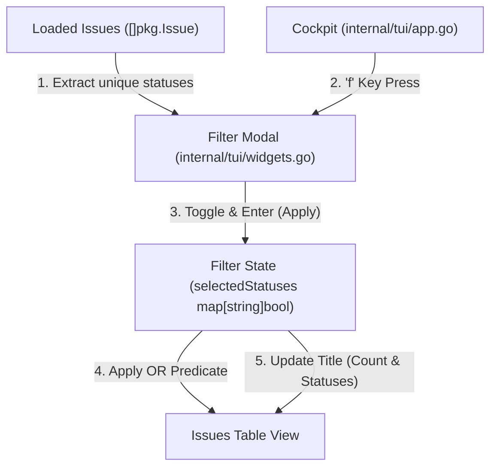

# 📋 [JC-20] Cockpit 다중 상태 필터링(Multi-Select OR 조건) 및 빠른 필터 기능 구현 계획

- **티켓 키**: [JC-20](https://joincdream.atlassian.net/browse/JC-20)
- **티켓 요약**: `[TUI] Cockpit 다중 상태 필터링(Multi-Select OR 조건) 및 빠른 필터 기능 구현`
- **담당자**: 윤상배 & AI 에이전트
- **상태**: 진행 중 (In Progress)
- **라벨**: `Development`, `Architecture`

---

## 💡 엔지니어링 및 개발자 관점의 핵심 개선 효과 (What Changes?)

| 구분 | ❌ 현재 구현 (Before) | ✨ 개선 후 구현 (After) |
| :--- | :--- | :--- |
| **티켓 목록 가독성** | 할 일(To Do), 완료(Done), 진행 중 등 모든 상태의 티켓이 단일 테이블에 혼재되어 수십 개 이상 누적 시 탐색 불가 | 원하는 상태(Status)들만 체크하여 관심 있는 티켓만 선별 조회 (노이즈 대폭 감소) |
| **상태 필터링 유연성** | 필터 기능 자체가 부재함 | 프로젝트 내 존재하는 고유 상태를 동적 추출하여 **다중 선택(OR 조건)** 지원 (예: `To Do` OR `In Progress`) |
| **조작 편의성 (DX)** | 별도 필터 조작 방법 없음 | 단축키 `f`로 팝업 호출, `Space`로 토글, `u`(미해결 일괄 선택), `a`(전체 선택) 등 원터치 숏컷 제공 |
| **필터 상태 피드백** | 전체 건수만 표시 (`Active Issues (42)`) | 적용된 필터 조건과 필터링된 건수 명시 (`Issues (12/48) [Filter: In Progress, Review]`) |

---

## 1. 개요 및 배경 (Background & Objectives)

### 1.1 배경
- Jira CLI의 Cockpit TUI(`jira tui`) 모드는 실시간 이벤트 감시와 이슈 조회를 위한 대시보드를 제공하지만, 모든 상태의 이슈가 한 번에 나열되어 프로젝트 규모가 커질수록 원하는 이슈를 식별하기 어렵습니다.
- 특히 완료(Done/Closed)된 티켓이 누적되면 활성 업무 파악에 방해가 되며, 팀마다 서로 다른 커스텀 워크플로우 상태(Review, QA, Deploy 등)를 유연하게 묶어서 볼 수 있는 OR 조건 필터링이 필수적입니다.

### 1.2 목표
1. **동적 상태 추출**: 현재 로드된 이슈 목록에서 중복 없는 고유 상태(Status) 목록을 실시간으로 수집.
2. **다중 선택(OR 조건) 필터 모달 (`f`)**: 모달 팝업에서 여러 상태를 체크박스로 선택 및 토글.
3. **원터치 빠른 숏컷**:
   - `u`: 미해결(Unresolved - Done/Closed 제외) 상태 일괄 선택.
   - `a`: 전체 상태 선택.
   - `c`: 전체 해제.
4. **테이블 렌더링 연동**: 선택된 상태 조건에 맞는 이슈만 필터링하여 테이블에 렌더링하고, 상단 타이틀에 필터 현황 표시.

---

## 2. 아키텍처 및 상세 설계 (Design Specification)

### 2.1 데이터 모델 및 상태 관리 (`Cockpit` 구조체 확장)
- `selectedStatuses map[string]bool`: 활성화된 상태 필터 집합 (비어있으면 전체 표시).
- `filterActive bool`: 필터 적용 활성화 여부.
- `filteredIssues []pkg.Issue`: 필터 조건이 적용된 현재 표시 이슈 슬라이스.

### 2.2 모달 컴포넌트 설계
- **단축키**: `f` (Filter)
- **컨테이너**: 화면 중앙 고정 크기 모달 (`tview.Flex` / `tview.Pages`)
- **컨트롤 키바인딩**:
  - `↑ / ↓`, `j / k`: 상태 항목 이동
  - `Space`: 개별 상태 체크 토글 (`[X]` ↔ `[ ]`)
  - `u`: 완료 상태(Done/Closed 등)를 제외한 미해결 항목만 일괄 선택
  - `a`: 전체 항목 일괄 선택
  - `c`: 전체 항목 체크 해제
  - `Enter`: 필터 적용 후 모달 닫기
  - `ESC`: 변경 사항 취소 후 모달 닫기

### 2.3 UI 타이틀 및 카운트 표시
- 필터 미적용 시: `📋 Issues (48)`
- 필터 적용 시: `📋 Issues (12/48) [Filter: In Progress, Review]`

---

## 3. 구현 단계별 실행 계획 (Action Items)

### 단계 1: 상태 추출 및 필터 로직 구현
- [x] `internal/tui/app.go` / `internal/tui/widgets.go`:
  - `selectedStatuses` 상태 맵 및 `GetUniqueStatuses()` 유틸리티 함수 구현.
  - `FilterIssuesByStatus()` 함수를 통해 원본 `issues`에서 조건에 맞는 `filteredIssues` 추출 로직 작성.

### 단계 2: 필터 모달 팝업 구현
- [x] `internal/tui/widgets.go` / `internal/tui/app.go`:
  - `showStatusFilterModal()` 함수 구현 (체크박스 목록, 키바인딩, 설명 푸터).
  - `tview.Pages`를 활용한 모달 오버레이 레이아웃(`centerModal`) 구성.

### 단계 3: Cockpit 키바인딩 및 렌더링 연동
- [x] `internal/tui/app.go`:
  - 전역 단축키 `f` 등록 및 모달 토글 처리.
  - 필터 적용 시 `refreshIssuesTable()`가 `filteredIssues`를 기준으로 테이블 렌더링하도록 갱신.
  - 테이블 헤더 및 푸터 가이드 텍스트 업데이트 (`[f] Filter`).

### 단계 4: 테스트 및 검증
- [x] `internal/tui/tui_test.go`:
  - 동적 상태 추출 단위 테스트 (`TestGetUniqueStatuses`).
  - 다중 상태(OR) 필터링 로직 단위 테스트 (`TestFilterIssuesByStatus`).
  - 빈 결과, 미해결(Unresolved) 프리셋 필터링 검증 (`TestTUI_Filter_Utilities`, `TestCockpit_StatusFilter_Modal_And_Filtering`).
- [x] 전체 테스트 스위트 통과 검증 (`go test ./...` 100% Pass).

---

## 4. 검증 체크리스트

- [x] `jira tui` 빌드 및 설치 성공 (`make install`).
- [x] `f` 키 입력 시 상태 필터 팝업 모달 노출 로직 연동.
- [x] `Space` 토글 및 `Enter` 적용 시 테이블 목록이 즉시 갱신되는지 확인.
- [x] `u` 단축키로 미해결 티켓만 즉시 필터링되는지 확인.
- [x] 필터 적용 후에도 상세 뷰(`onIssueSelectionChanged`) 및 브라우저 열기(`o`)가 정상 동작하는지 확인.
- [x] `go test ./...` 전체 테스트 패스.
